# Claude Session Dashboard

A Windows desktop app that collects every Claude Code session from **Windows and WSL**, shows each one
as a readable conversation, lets you name, describe and tag it, keeps a permanent archive, and
resumes any session in a terminal with its full context.


- **Every session in one place.** Your Windows profile and every WSL distro (each user in `/home`,
  plus `/root`), plus any extra folders you add. New and updated sessions show up live.
- **Readable transcripts.** Chat bubbles, Markdown, syntax-highlighted code, and collapsed tool calls
  (`▸ Edit src/app.ts`, `▸ Bash: npm test`) and thinking blocks that you expand on click.
  Find-in-session with <kbd>Ctrl</kbd>+<kbd>F</kbd>.
- **Your own names, descriptions and tags.** Stored only in the app's own metadata file and never
  written into Claude's files. Untitled sessions fall back to Claude's summary, then to the first
  message.
- **Resume and Fork** in Windows Terminal (or PowerShell / cmd). `--dangerously-skip-permissions`
  is on by default, with a per-launch checkbox and a warning label. "Copy resume command" lets you
  paste it yourself.
- **Branch from any message.** Hover a message and click **Branch** (or right-click it) to continue
  the conversation from that point in a new session, with the same launch options as Resume. Branches
  and forks show up in a **Branches** panel with a small family tree, and the list can group them
  under their parent. Forks made outside the app are detected too. See [Branching](#branching).
- **A permanent archive.** Every session file is copied to `%APPDATA%\ClaudeSessionDashboard\archive`,
  so sessions survive Claude Code's `cleanupPeriodDays` cleanup. If the original is gone, Resume puts
  the archived copy back first (it never overwrites an existing file).
- **Full-text search** across names, descriptions, tags and all message text, plus filters for
  project, environment, tag, date range and hidden sessions.
- **Usage & limits** (<kbd>Ctrl</kbd>+<kbd>U</kbd>): your real 5-hour and weekly plan percentages
  (opt-in) with pacing, every token you've used since the first session, per model / session /
  project / source / day, API credits and cost, model trends ("is it nerfed?") and **Limit health**,
  which checks whether each 1% of your plan still buys as much work as it used to. Also in the tray,
  a mini meter and the title bar. See [Usage, limits and API credits](#usage-limits-and-api-credits).
- **Where each session came from.** Every session is labelled with the product that ran it
  (Terminal on Windows or WSL, VS Code, JetBrains, the desktop app, the SDK / `claude -p`, or a cloud
  session teleported here), with a Source filter in the sidebar.
- **Ask Claude** about your usage ("Have my limits dropped?") through the official CLI on your own
  plan. Only aggregated numbers are sent, and you see exactly what first.
- **claude.ai conversations too.** Import a claude.ai data export to read and search those
  conversations next to your sessions (view only).
- **Keyboard first.** <kbd>Ctrl</kbd>+<kbd>K</kbd> command palette, <kbd>J</kbd>/<kbd>K</kbd> to move,
  <kbd>Ctrl</kbd>+<kbd>Enter</kbd> to resume, <kbd>?</kbd> for every shortcut. Light, dark and
  system themes.

## Safety

The app is built around these rules (see `CLAUDE.md`):

1. **It never deletes or modifies anything under any `.claude` folder.** It only reads. The one
   exception: when you resume a session whose file is _missing_, it copies the archived copy back to
   the original path. That copy uses an exclusive-create flag, so it can never overwrite a file.
   Every other write goes through a guard that refuses any path inside a `.claude` folder or outside
   the app's data folder. **Branch from here** adds one more narrow case: it creates one _new_
   session file next to the session it branches from (see [Branching](#branching)). It never
   changes or deletes an existing file.
2. The app's own data lives only in `%APPDATA%\ClaudeSessionDashboard\` (metadata, settings, archive,
   cache, and Chromium's own files).
3. There is no "delete session" feature. **Hide** is only a flag in the app's metadata.
4. **No network calls.** All outgoing requests from the window are blocked, remote images in
   transcripts aren't loaded, fonts are bundled, and spellcheck (which would download dictionaries)
   is off. Links in transcripts open in your browser only when you click them.
5. **Session files are untrusted input.** Launching only starts known programs by full path and never
   lets a recorded folder be read as a command (see [Using it](#using-it)). The windows answer IPC only
   from the app's own page, never navigate away, and get no web permissions. The packaged app has
   Electron's `RunAsNode`, `NODE_OPTIONS` and inspector switches turned off and only runs its own,
   integrity-checked `app.asar`.

Phase 5 ([`docs/PHASE-5-USAGE-TRACKING.md`](docs/PHASE-5-USAGE-TRACKING.md)) adds exactly two
exceptions, and each one only happens after you approve it in the app (the later additions below
add none):

- **Live limits** changes the `statusLine` key in a `~/.claude/settings.json`, and nothing else in
  `.claude`. You see the exact diff first, the file is backed up to the app's data folder, and
  **Disable** puts the previous value back exactly. The only other files it writes are its own, in
  `~/.claude-session-dashboard/`. A write guard refuses any other path inside `.claude`.
- **Admin API keys** let the app call two read-only reporting endpoints on `https://api.anthropic.com`
  (usage report and cost report). No other host, no other endpoint, and never any session content.
  Standard API keys cause no network calls at all.

Two later features stay inside the rules: **Import claude.ai data export** only reads the zip you
pick (it is never written) and stores the conversations in the app's archive, and **Ask Claude**
makes no network call itself: it starts your own `claude` CLI, which talks to Anthropic as it always
does, with no tools, and only after you've seen what will be sent.

## Run it on Windows

You need **Node.js 22.12 or newer** (the LTS from <https://nodejs.org> is fine) and **Git**.
No Visual Studio or other build tools are needed: the project uses no native Node modules.

Open **PowerShell** and run:

```powershell
git clone https://github.com/Beaulewis1977/claude-session-dashboard.git
cd claude-session-dashboard
npm install
npm run dev
```

The app opens and scans your sessions. To try it with the sample sessions in `fixtures/` instead
of your real data:

```powershell
npm run dev -- --fixtures
```

### Build the installer

```powershell
npm run dist
```

This creates two files in `release\1.0.0\`:

- `ClaudeSessionDashboard-Setup-1.0.0.exe` is the installer (per-user, no admin rights needed; you can
  pick the install folder).
- `ClaudeSessionDashboard-Portable-1.0.0.exe` runs without installing.

The executables aren't code-signed, so Windows SmartScreen may warn you the first time. Click
**More info**, then **Run anyway**.

### Other scripts

| Command                                | What it does                                                                                                   |
| -------------------------------------- | -------------------------------------------------------------------------------------------------------------- |
| `npm run dev`                          | Run with hot reload. Add `-- --fixtures` for sample data.                                                      |
| `npm start`                            | Run the last production build (`npm run build` first).                                                         |
| `npm test`                             | Unit and integration tests (Vitest).                                                                           |
| `npm run typecheck`                    | TypeScript checks for the main process and the renderer.                                                       |
| `npm run lint`                         | ESLint.                                                                                                        |
| `npm run check`                        | Typecheck, lint, test and build in one go.                                                                     |
| `npm run dist`                         | Build the Windows NSIS installer and the portable exe.                                                         |
| `npm run dist:dir`                     | Build an unpacked app folder (quick packaging check).                                                          |
| `npm run screenshots`                  | Run the app in fixtures mode and save screenshots to `docs/` (delete `.fixtures-data/` first for a clean run). |
| `node scripts/make-fixtures.mjs`       | Regenerate the sample sessions in `fixtures/`.                                                                 |
| `node scripts/make-usage-fixtures.mjs` | Regenerate the 13 weeks of sample usage in `fixtures/usage/`.                                                  |

## Using it

- **Rename / describe / tag:** click the title or description at the top of a session, or press
  <kbd>F2</kbd>, <kbd>D</kbd> or <kbd>T</kbd>. Changes save when you leave the field.
- **Resume / Fork:** <kbd>Ctrl</kbd>+<kbd>Enter</kbd> / <kbd>Ctrl</kbd>+<kbd>Shift</kbd>+<kbd>Enter</kbd>,
  or the buttons in the header. The dialog shows the exact command, whether the file will be
  restored from the archive, and whether the working folder still exists. If it doesn't, choose
  another folder. Fork adds `--fork-session` so the original session stays untouched.
- **Search:** press <kbd>/</kbd> and type. Results are sorted by relevance; a small "in messages" label
  means the match is in the conversation rather than the name or tags.
- **New session:** "New session in this folder…" in a session's ⋯ menu or the command palette.
- **Source labels:** each session card has a small badge for the product that ran it, and the
  sidebar's **Source** section filters by it. The label comes from the `entrypoint` Claude Code 2.x
  writes on every line (`cli`, `claude-vscode`, `claude-desktop`, `sdk-cli` for `claude -p`,
  `remote…` for cloud sessions), the claude.ai/code link a cloud session logs, IDE context attached
  to a CLI session (JetBrains when the IDE is named), whether the app launched it, and finally the
  working folder. Older versions record none of these, so their sessions show **Local · unknown**.
  Click the badge in a session's header to set it by hand; labels are kept in the app's metadata.
- **claude.ai conversations:** Settings → Archive → **Import claude.ai data export** (the zip from
  claude.ai → Settings → Privacy → Export data). The conversations appear under the claude.ai
  environment with a claude.ai badge: readable, searchable and exportable to Markdown, but with no
  token stats and no Resume (they never ran in Claude Code). Importing again updates changed
  conversations; the zip itself is only read.
- **Settings** (<kbd>Ctrl</kbd>+<kbd>,</kbd>): theme, terminal, the default for skipping permissions,
  scan sources with their status, extra folders, the archive location and size, and each Claude
  home's `cleanupPeriodDays` (read-only).

The launch commands are built as argument arrays, so paths with spaces work. Every program is
started by its full path (shown here by name):

```text
Windows session:  wt.exe -d "<cwd>" cmd.exe /s /k "\"<claude>\" --resume <id> [--dangerously-skip-permissions] [--fork-session]"
WSL session:      wt.exe wsl.exe -d <distro> --cd "<linux-cwd>" -- bash -lic "claude --resume <id> [...]"
```

If `wt.exe` isn't found, the app falls back to a new PowerShell window. You can also pick PowerShell
or cmd as your preferred terminal; they open in a new console window of their own.

- **Programs come from known places, never from the project folder.** Windows would otherwise look
  in the current folder first, so a `wt.exe`, `cmd.exe` or `claude.cmd` in a project could stand in
  for the real one. `cmd.exe`, PowerShell and `wsl.exe` come from `System32`, Windows Terminal from
  its app alias, and Claude Code from the absolute folders on your `PATH` (what typing `claude`
  would run). If Claude Code isn't found, the dialog says so instead of launching. npm's
  `claude.cmd` starts `node` by name, so the command first turns off the current-folder lookup
  (`NoDefaultCurrentDirectoryInExePath`); the app sets the same for everything it starts.
- **The folder is never read as a command.** cmd starts _in_ the folder instead of being given it,
  PowerShell only sees it as a literal string, and a folder whose name Windows Terminal or cmd would
  read specially (`;` or `%`, a network share for cmd) opens in PowerShell instead, with a note in
  the dialog. A WSL folder with a quote, backslash or control character in its name is refused. A
  WSL folder is checked through `\\wsl.localhost\<distro>` before launching (for a stopped distro,
  opening the Resume dialog starts it); if the distro can't be reached, nothing is launched.

### Branching

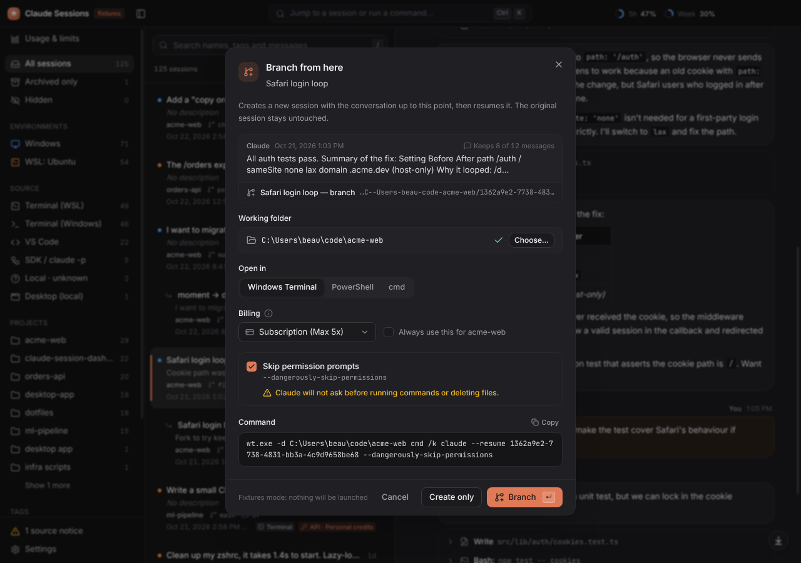

- **Branch from here:** hover a message (yours or Claude's) and click **Branch**, or right-click it.
  Right-clicking one of your messages also offers **Branch from before this message**, to ask
  something different from that point. The dialog shows the message the branch ends with, how many
  messages it keeps, the new file, and the usual launch options (folder, terminal, billing,
  `--dangerously-skip-permissions`). **Branch** creates the session and resumes it; **Create only**
  just creates it.
- **The first time**, the app explains what it writes and asks you to confirm: one new session file
  (with a new session id) in the same project folder in `.claude/projects`. Nothing existing is
  changed or deleted, so the original session stays exactly as it was.
- **Tool calls stay whole.** If the message you pick calls tools whose results come later, the
  branch includes those results. If that isn't possible (for example, you typed a new message before
  a result arrived), it ends at the nearest earlier point where every tool call has its result. The
  dialog tells you when this happens.
- **Naming:** a new branch is called `<parent name> — branch` (numbered if that's taken) and opens
  with its name selected, so you can type a better one straight away. Forks started with the **Fork**
  button get the same name when they appear.
- **Fork** (the button next to Resume) still branches from the end with `claude --resume <id>
--fork-session`.
- **Lineage:** the **Branches** section at the top of a session shows where it was branched from
  (and after which message), and a tree of the whole family; click any entry to open it. In the
  transcript, a marker shows where a branch starts, and where other branches split off. In the list,
  branches sit under their parent (turn this off in the sort menu: **Group branches under parent**).

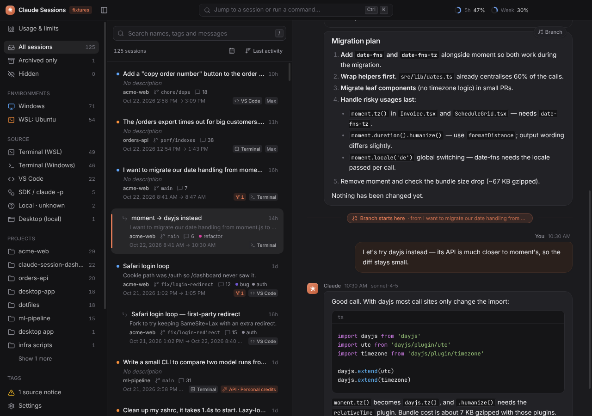

### Keeping sessions longer in Claude Code itself

Claude Code deletes sessions older than `cleanupPeriodDays` (30 by default). The archive keeps them
anyway, but if you also want Claude Code to keep them, add this to `%USERPROFILE%\.claude\settings.json`
(and `~/.claude/settings.json` inside WSL). The app shows the current value but never edits this file.

```json
{ "cleanupPeriodDays": 3650 }
```

## Usage, limits and API credits

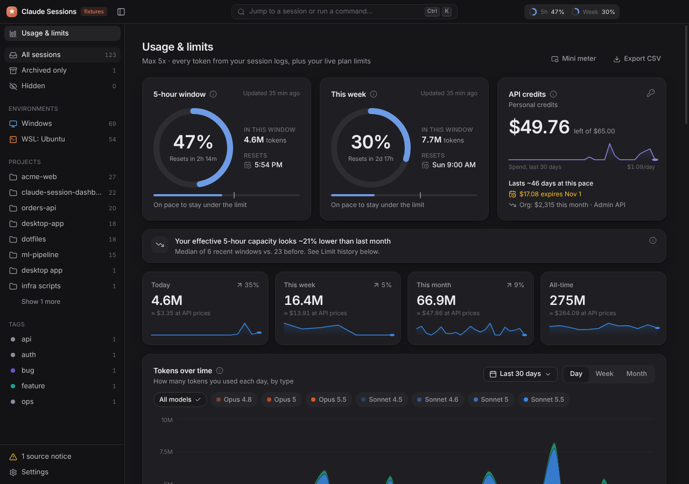

Open it from the sidebar (**Usage & limits**), with <kbd>Ctrl</kbd>+<kbd>U</kbd>, by clicking the
gauges in the title bar, or from the tray icon.

- **Live limits:** two ring gauges for the **5-hour window** and **this week**, the same percentages
  Claude Code shows in `/usage`, with a reset countdown, the tokens you used in that window (from your
  logs) and a projection ("On pace to hit 100% at 4:30 PM"). Desktop notifications at 75% and 90%
  (Settings → Live limits; change or turn off).
- **Pacing:** a tick on each gauge marks where your usage should be by now to end the window at
  your cap (90% by default), with **Behind / On pace / Ahead** and the room you have left per hour.
  A line of advice under the gauges treats the weekly window as the main limit.
- **Limit health:** is each 1% of your plan buying less work than it used to? See
  [Limit health](#limit-health-did-my-limits-get-smaller) below. Next to it, **Where your limits
  went** splits the current windows by source, with an "Elsewhere" slice for usage your logs don't
  explain (claude.ai, the apps, cloud sessions).
- **Ask Claude:** a side panel with suggested questions and a free-text box. See
  [Ask Claude](#ask-claude).
- **Every token, forever:** read from every session file and from the app's archive, so history
  survives Claude Code's cleanup. Today / this week / this month / all-time cards (click one to
  filter the charts), a stacked chart of input, output, cache-write and cache-read tokens by
  day/week/month with a date range picker and model filter, a model share donut, the top sessions,
  and a raw table with breakdowns by model, session, project, environment, Claude Code version,
  billing or source. CSV export. Per-session usage appears at the top of each session.
- **API credits:** run any session on an API key instead of your plan, track credit grants, spending,
  burn rate and "lasts ~N days", and (with an Admin key) your organization's cost report.
- **Trends ("is it nerfed?") and limit history:** weekly indicators per model and per Claude Code
  version, with markers for new models, updates, plan changes and $-per-1% changes, and a compare
  mode. The Limit history tab lists every "limit reached" message, recent 5-hour blocks, and the
  times you marked as "used Claude elsewhere".
- **At a glance:** small gauges in the title bar, a tray icon with the 5-hour % (hover for both
  windows, click to open Usage), and an always-on-top **mini meter** you can drag anywhere (it
  remembers where).

|                                                    |                                                      |
| -------------------------------------------------- | ---------------------------------------------------- |
| 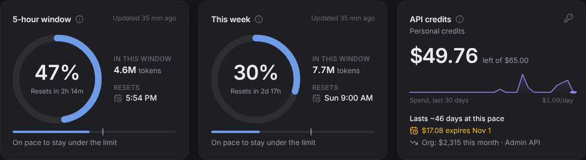            | 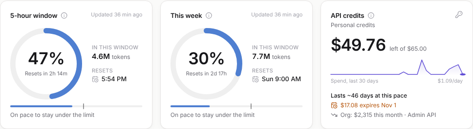       |
| 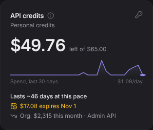           | 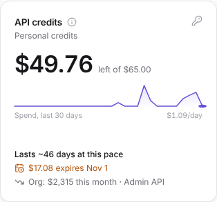      |
| 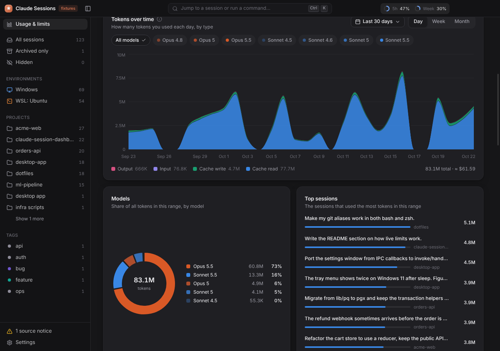                   | 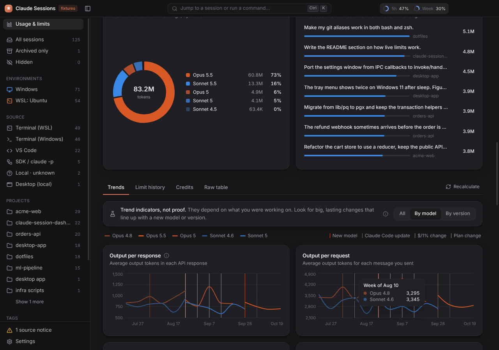                           |
| 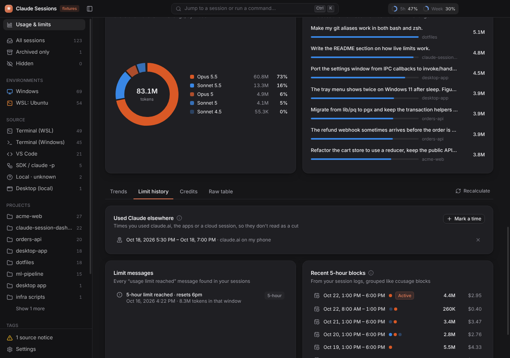           | 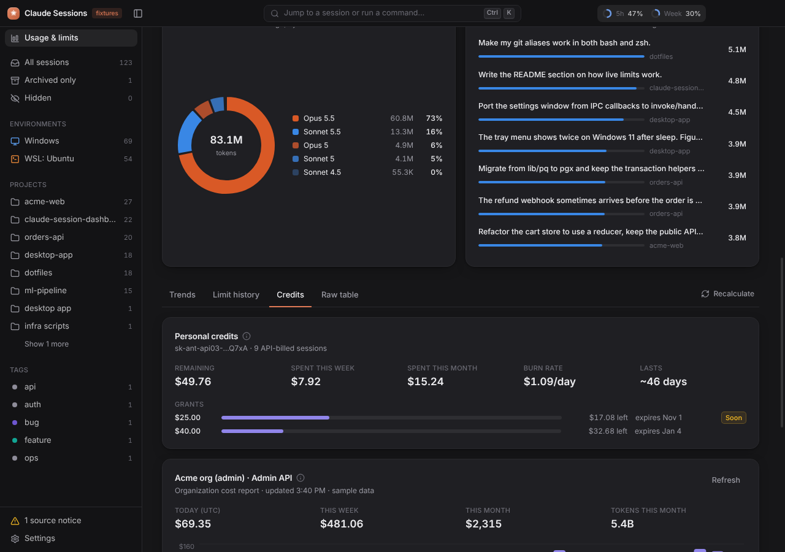                 |
| 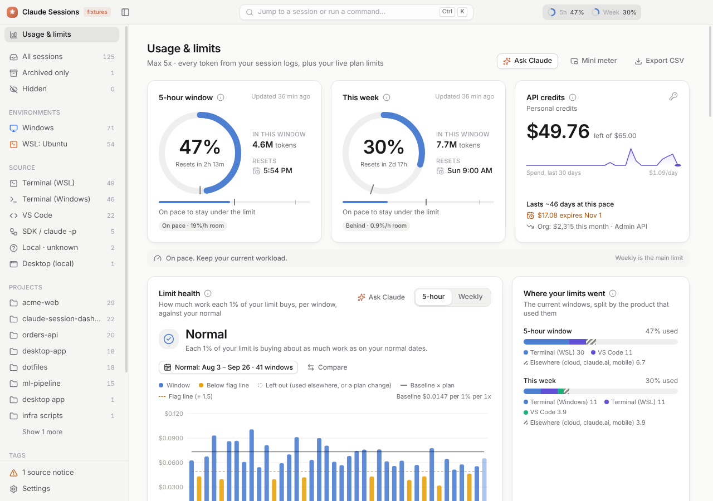             | 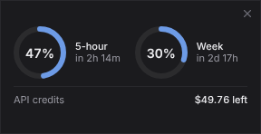                   |
| 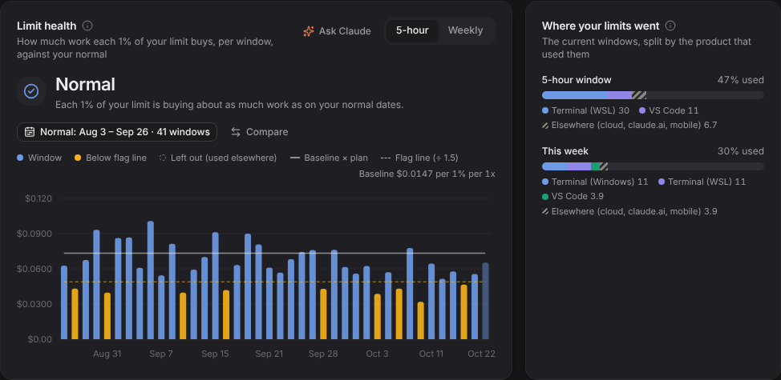             | 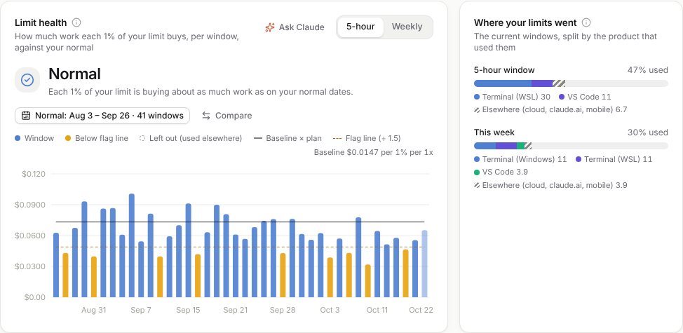 |
| 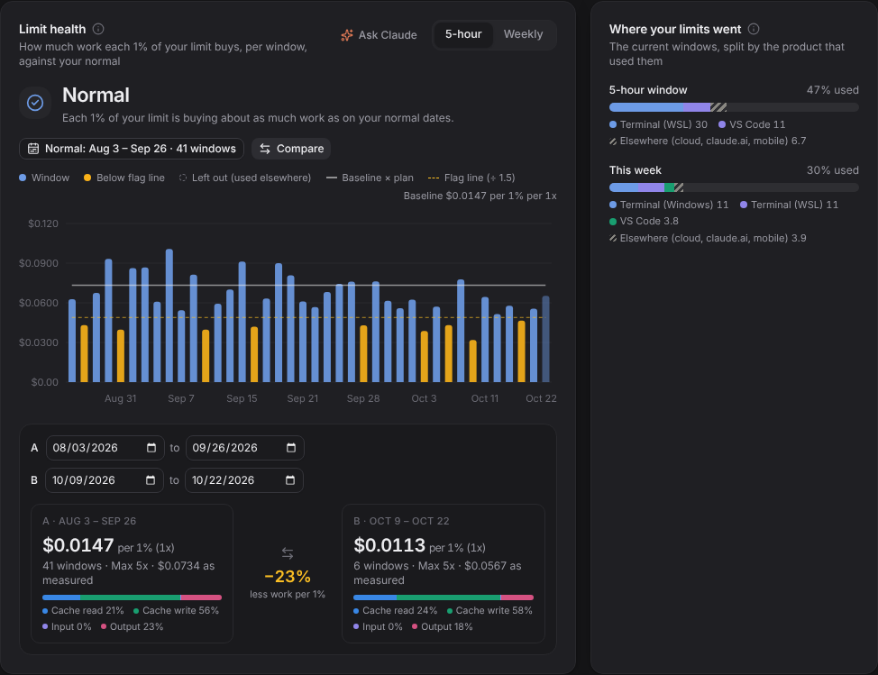 | 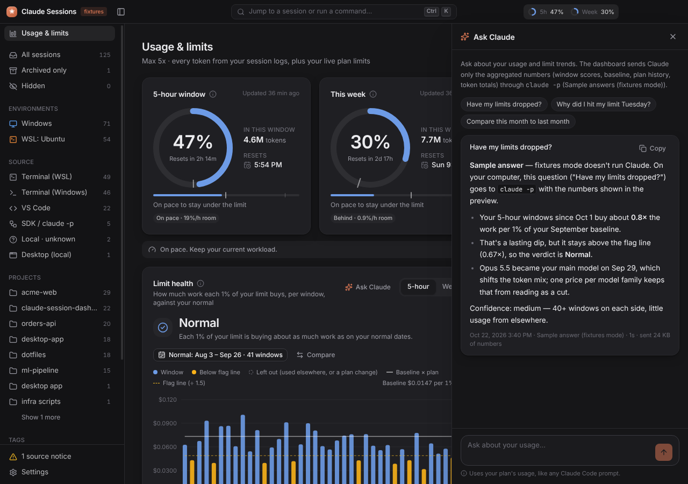                   |
| 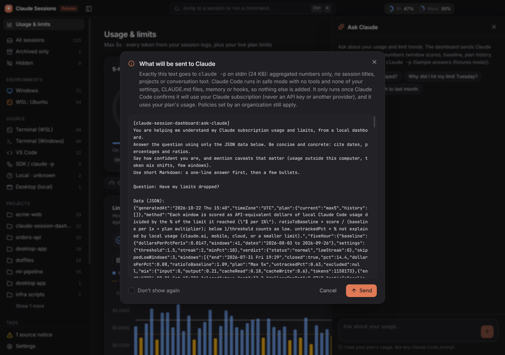     |                                                      |

### Turn on live limits

Claude Code passes a JSON payload to its status line command on every update, and for Pro and Max
subscribers that payload includes `rate_limits.five_hour` and `rate_limits.seven_day` (used % and
reset time). This is the only supported way to get your real plan percentages locally, so the app
installs a tiny **status line bridge** that saves that payload for it.

1. Open **Settings → Live limits** (or click **Enable live limits** on the Usage view).
2. Pick your plan (default **Max 5x**).
3. Click **Enable live limits** next to each environment you use: **Windows**, and each WSL distro
   user (for example **WSL: Ubuntu · beau**).
4. Read the dialog. It shows the exact change to that environment's `settings.json` and, if you
   already have a status line, the command the bridge will pass the data on to. Click **Enable live
   limits**.
5. Send any message in Claude Code. The gauges fill in after its next status line update.

What it changes:

```diff
 {
   "theme": "dark",
   "statusLine": {
     "type": "command",
-    "command": "~/.claude/statusline.sh",
+    "command": "powershell -NoProfile -NonInteractive -ExecutionPolicy Bypass -File \"C:/Users/you/.claude-session-dashboard/bin/statusline.ps1\"",
     "padding": 0
   }
 }
```

- Only the `statusLine` value changes. Other keys, their order and the file's formatting stay
  byte-for-byte the same. `padding` and `refreshInterval` are kept.
- Before writing, `settings.json` is copied to
  `%APPDATA%\ClaudeSessionDashboard\backups\settings\<environment>-<time>-settings.json`
  (**Backups** opens the folder). The app refuses to edit a `settings.json` that isn't valid JSON, or
  one that changed after you reviewed the diff.
- The bridge script goes to `%USERPROFILE%\.claude-session-dashboard\bin\statusline.ps1` on Windows
  and `~/.claude-session-dashboard/bin/statusline.sh` in WSL (POSIX `sh`, no `jq` or `node` needed).
  It saves each payload atomically to `~/.claude-session-dashboard/live/<session-id>.json` and
  `latest.json`.
- **Your existing status line keeps working.** If you had one, the bridge passes it the same JSON and
  prints its output (on Windows through Git Bash when Claude Code uses it, otherwise PowerShell). If you
  didn't, it prints `Opus · 5h 23% · week 41% · ctx 8%`. On any error it prints nothing and exits 0.
- **Disable** (same dialog) restores your previous `statusLine` exactly: the original file when
  nothing else changed since, otherwise just the old `statusLine` value. If there was no
  `settings.json` before, Disable leaves `{}` (the app never deletes files in `.claude`).
- Every reading is kept forever in `%APPDATA%\ClaudeSessionDashboard\limits-history.ndjson`.
- Settings shows each environment's status and when data last arrived. Without the bridge, the
  5-hour gauge falls back to a log-only estimate of the current 5-hour block (like `ccusage blocks`).

Notes: the `sh` bridge runs in about 20 ms. On Windows, PowerShell's own startup adds roughly
0.2–0.4 s; Claude Code runs the status line in the background, so you won't wait on it. `rate_limits`
only appears for Claude subscriptions, and only after the first response in a session.

### Add an API key

**Settings → Accounts & API credits → Add API key…**, give it a nickname and paste the key.

- **Standard keys** (`sk-ant-api…`) let you run sessions on API credits and track what they cost.
  The app makes no network calls with them.
- **Admin keys** (`sk-ant-admin…`) also pull your organization's daily usage and cost from the
  Usage & Cost Admin API (refresh on demand, or every 15 min / hourly / 6 h). Individual accounts
  can't create Admin keys; they need an organization in the Claude Console.
- Keys are encrypted with Windows (Electron `safeStorage`, which uses DPAPI) and stored only as
  ciphertext in `%APPDATA%\ClaudeSessionDashboard\accounts.json`. They're shown masked
  (`sk-ant-api03-…Q7xA`), never logged, never sent to the window, and never written in plain text. If
  encryption isn't available, the app refuses to store the key.
- **Credit grants:** there's no API for your remaining balance, so enter each grant you receive
  (amount, date, optional expiry) under the key. The Usage view shows the balance, spending this
  week and month, the burn rate, how long the credits last at this pace, and grants that expire soon.

**Running a session on API credits:** in the Resume, Fork or **New session** dialog, change **Billing**
from **Subscription (Max 5x)** to **API key: <nickname>**. Tick **Always use this for <project>** to
make it that project's default; the overall default is in Settings.

- The key goes only into the environment of that one terminal: `ANTHROPIC_API_KEY` for Windows
  sessions, and `ANTHROPIC_API_KEY` plus `WSLENV=ANTHROPIC_API_KEY/u` for WSL sessions. It's never put
  on the command line (where other programs could see it), in `settings.json`, in shell profiles, in
  global environment variables or in logs. "Copy resume command" never includes it.
- API-billed launches open **PowerShell** instead of Windows Terminal: a new Windows Terminal window
  can join one that's already running and get that window's environment instead of the key. The
  dialog says so.
- Claude Code may ask once to confirm that it should use the key.
- Sessions get a **Max** or **API · nickname** badge. Sessions launched outside the app are inferred
  from the status line bridge: `rate_limits` means your subscription; a cost without `rate_limits`
  most likely means API. Otherwise the billing shows as unknown. You can't detect it from the log
  files alone.

### Limit health ("did my limits get smaller?")


Each 5-hour (and weekly) window gets one score: **API-equivalent dollars per 1%**. The app prices
the tokens you used in the window (from your logs, subagents included, each response counted once)
at the price table's API rates for input, output, cache reads and 5-minute / 1-hour cache writes,
and divides by the % the window reached. A higher score means 1% bought more work.

1. **Pick your normal dates** on the card: a stretch when your limits felt normal. The median score
   of those windows is your **baseline**, stored per 1x of plan.
2. **Plan history** (Settings → Limit health): Pro = 1x, Max 5x = 5x, Max 20x = 20x, or a custom
   multiplier, each with a start date. Every window is compared with baseline × the multiplier of
   the plan it ran on, so one baseline works across plans and an upgrade doesn't read as a cut. With
   no history, your current plan (Max 5x by default) applies to every window; changing the plan in
   Settings records the switch for you. The chart marks plan changes. A window is scored with the
   plan in effect when its reading was taken; a window that spans a plan change is left out, since
   its 1% has no single size.
3. **The verdict.** "Possible reduction" only when the last **2** finished windows in a row (setting)
   fell below baseline ÷ **1.5** (setting). Windows under **10%** are skipped as too coarse. Until
   there are enough windows it says "Not enough data yet, N windows needed".
4. **Token mix.** Hover a bar to see how its dollars split between input, output, cache reads and
   cache writes; a big shift in mix can move the score on its own.
5. **Compare** two date ranges side by side ($ per 1% per 1x, as measured, plans and mix) with the %
   change.

Details that keep the score honest:

- **One price per model family** (on by default): every Opus model is priced at the newest Opus in
  your price table, and the same for Sonnet and Haiku. Without it, moving to a model with lower API
  prices (Opus 5.5 costs less than Opus 5) looks like a smaller limit.
- **Usage elsewhere.** Usage from claude.ai, the apps, cloud sessions or another computer raises
  the % with no matching local tokens, which looks like a cut. When the % rose while nothing ran on
  this computer, that part is clear evidence; windows where it's 25% or more (setting) are left out
  of the baseline and the verdict, and drawn dashed. The rest is estimated from your baseline and
  shown as a warning on the window, because a real cut looks the same. You can also mark time
  ranges as "used Claude elsewhere" (Limit history tab).
- **Backfill.** If you ran `/usage` in Claude Code before turning on live limits, the percentages it
  printed are in your transcripts. The app reads them as extra readings (reset times like "Resets
  7pm (America/Los_Angeles)" are parsed in that time zone).
- It's a trend indicator, not proof: Anthropic's limits aren't published as token counts.

The method comes from [claude-nerf-watcher](https://github.com/One-Lyf/claude-nerf-watcher) and the
pacing from [claude-usage-pacer](https://github.com/One-Lyf/claude-usage-pacer) (both MIT). Both of
those read Claude's OAuth token and call an undocumented usage endpoint; this app does neither. Its
percentages come only from the status line bridge and recorded `/usage` output.

### Ask Claude


**Ask Claude** (Usage view, or the Limit health card) answers questions like "Have my limits
dropped?", "Why did I hit my limit Tuesday?" or "Compare this month to last month".

- It runs your own Claude Code: the Windows install if there is one, otherwise the default WSL
  distro. The command is fixed:
  `claude -p --output-format json --tools "" --strict-mcp-config --safe-mode --setting-sources ""`,
  so Claude has **no tools** and no MCP servers, and `--dangerously-skip-permissions` is never used.
  `--safe-mode` keeps your CLAUDE.md files, auto memory, hooks, plugins and skills out of the
  request, and `--setting-sources ""` loads none of your settings files, so nothing beyond the
  previewed text is added. (Settings your organization manages still apply.) The question and the
  data go in on **stdin**, never on the command line.
- **Only on your Claude subscription.** Claude Code gets a minimal environment built from an
  allowlist: what Windows, WSL and Node need to start, proxy and certificate settings, and your
  subscription login (`CLAUDE_CODE_OAUTH_TOKEN`, `CLAUDE_CONFIG_DIR`). API keys, custom headers,
  gateway tokens, base URLs and provider switches (and anything a later Claude Code adds) never
  reach it. In WSL the same allowlist is applied with `env -i` after your login profile has
  loaded. Then `claude auth status`, run in that same environment, must confirm the subscription
  before the question is sent. If Claude Code would use an API key, Bedrock, Vertex or anything
  else billed separately, Ask Claude stops and says why. An older Claude Code that doesn't know the
  safe-mode flags is asked to update instead of running without them.
- **Only aggregated numbers are sent**, as compact JSON: window scores and ratios, the baseline,
  plan history, pace, daily and monthly token totals, the dates models and Claude Code versions
  first appeared, untracked-usage estimates and when limits were reached. No session titles,
  project names, ids or conversation text. Before the first question you see exactly what will be
  sent, with "Don't show again" (Settings → Ask Claude turns the preview back on).
- A timeout (180 s by default) and **Cancel** stop the run (Cancel works at any point, also before
  anything has started). Answers show as formatted text with a
  Copy button, and every question and answer is kept in the app's `ask-history.json`.
- **It uses your plan's usage**, like any Claude Code prompt. Claude Code also logs each run as a
  session; the app recognises them by the marker at the start of the prompt, labels them **Ask
  Claude (dashboard)** and hides them from the list (pick that source in the sidebar to see them).
  Their tokens still count in Usage.

### What the numbers mean (and their limits)

- **5-hour / weekly %**: exactly what Claude Code reported in its last status line update. "Updated
  35 min ago" tells you how old it is; after 1 hour it says "open Claude Code to refresh". A window
  whose reset time has passed shows 0% until the next update.
- **Tokens in this window**: subscription-billed tokens from your logs since the window started
  (reset time minus 5 hours or 7 days).
- **Pace**: for the 5-hour window, the trend of the last 90 minutes of readings; for the week, the
  average since the week started (so nights and days off count). "On pace to hit 100% at …" is a
  straight-line projection.
- **Token types**: _input_ is new prompt text, _output_ is what Claude wrote, _cache write_ is
  context stored in the prompt cache, _cache read_ is context re-read from the cache. Cache reads are
  cheap and are usually 90%+ of Claude Code's volume. Every API response is counted once, with the
  same rules as ccusage (see "Matching ccusage" below), including subagent transcripts and forked
  sessions.
- **Cost / ≈ $**: an estimate at API list prices from the editable price table (Settings → Usage).
  The table is pre-filled from a bundled snapshot of LiteLLM's price data dated 22 Oct 2026 (the
  source ccusage uses; it matches Anthropic's published prices). Fast mode is priced with the
  snapshot's multiplier (×2 for Opus 5.5), and a request over a model's long-context threshold
  (Haiku 5.5: 100K input tokens) is billed entirely at the higher tier. Old Claude Code versions
  logged a `costUSD` per response; when it's there, it's used instead of the estimate. On a
  subscription you don't pay this; it's a way to compare. The credits tracker prefers Claude Code's
  own `cost.total_cost_usd` for each API-billed session and only falls back to the price table when
  that's missing.
- **Period cards**: the change compares with the same elapsed part of the previous day, week or month.
- **Pace target**: cap × the share of the window that has passed. Within ±5 points (setting) is on
  pace; "room left per hour" is how many points per hour you can still use and end at the cap.
- **$ per 1%** (Limit health): see above. The older **implied capacity** (weighted tokens ÷ %, with
  the weights in Settings → Usage) is still computed, but the Limit health score replaces its chart,
  its banner and its trend markers.
- **Where your limits went**: the local part of a window's % is split by each source's share of the
  API-equivalent dollars; "Elsewhere" is the part your logs don't explain (estimated from the
  baseline when you have one, otherwise only rises while nothing ran here).
- **Trends**: weekly per model or per Claude Code version: output per response and per request,
  response time (median, ignoring gaps over 10 minutes), tool error rate, API errors and retries,
  assistant turns and tool calls per request, interruptions and corrections (messages after an
  interruption, or starting with "no", "wrong", "that's not"), cache read ratio, thinking blocks and
  their length (newer Claude Code versions often don't save thinking text), and context window use
  (from the bridge). They depend on what you were working on, so they're indicators, not proof.
- **Admin API figures** cover the whole organization (every key and person), not just this computer.
- **Verify against ccusage** (Settings → Usage) runs `ccusage daily --json` if it's installed and
  compares per day. ccusage only reads the Windows profile, so it's compared with Windows sessions.
  ccusage is not bundled or installed by the app.

### Matching ccusage

[ccusage](https://github.com/ccusage/ccusage) (MIT) was used as the reference for reading Claude Code
logs. The app has its own code, written from ccusage's behavior; `THIRD_PARTY_NOTICES` carries its
license. A test (`tests/ccusage-parity.test.ts`) runs a small model of ccusage's loader and the
app's parser over every fixture file and checks that the daily and per-model token totals are the
same. What we took from it:

- **Counting a response once.** Message id + request id identify a response across all sessions.
  Without a request id, the id only counts once per session, and placeholder ids from gateways (not
  `msg_…`) also need the same timestamp. When copies disagree, the one with more tokens wins (a
  main-thread copy beats a sidechain copy). A `/btw` sidechain that replays a parent message with a
  new request id is the same response. Lines without a message id are always counted.
- **Which lines count.** Input and output token counts must be present; lines with a non-semver
  `version`, or an empty session id, request id, message id or model, are skipped. When
  `cache_creation` reports the 5m/1h split, that's the cache-write count. Advisor sub-calls in
  `usage.iterations` count as their own responses under their own model. `usage.speed: "fast"`
  shows as e.g. "Opus 5.5 (fast)".
- **5-hour blocks.** A block starts at the hour of its first response and takes every response up to
  exactly 5 hours later, until a gap of more than 5 hours.
- **Prices** come from LiteLLM's data, as ccusage's do.

Where we differ on purpose: synthetic messages (Claude Code's own notices, always 0 tokens) aren't
listed; responses copied into a fork stay with the session that logged them first; and ccusage can
fetch current prices when it runs, while the app only uses its bundled snapshot.
When the new rules first run, usage is re-read session by session from the logs and the archive;
records of sessions whose files are gone are kept as they were.

### Where the data lives

| File (in `%APPDATA%\ClaudeSessionDashboard\`)           | What's in it                                                                                                   |
| ------------------------------------------------------- | -------------------------------------------------------------------------------------------------------------- |
| `usage\records-YYYY-MM.ndjson`                          | One line per API response: time, session, project, environment, model, version, stop reason, every token count |
| `usage\turns-YYYY-MM.ndjson`, `usage\limit-hits.ndjson` | Per-request metrics for Trends, and every "usage limit reached" message                                        |
| `limits-history.ndjson`                                 | Every status line reading                                                                                      |
| `usage\usage-readings.ndjson`                           | Limit readings found in `/usage` output in transcripts (backfill)                                              |
| `ask-history.json`                                      | Ask Claude questions and answers                                                                               |
| `archive\claude-ai\`                                    | Conversations imported from a claude.ai data export                                                            |
| `accounts.json`                                         | API keys (encrypted), credit grants, cached Admin reports                                                      |
| `bridge.json`, `backups\settings\`                      | What the installer changed, and the `settings.json` backups                                                    |

**Recalculate usage** (Usage view or Settings → Usage) re-reads every session from scratch.

## Screenshots

|                                                    |                                                      |
| -------------------------------------------------- | ---------------------------------------------------- |
| 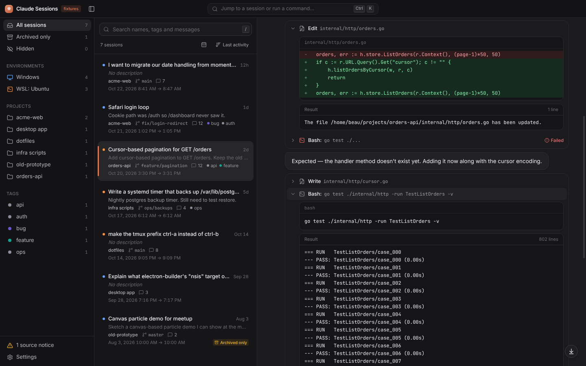                      | 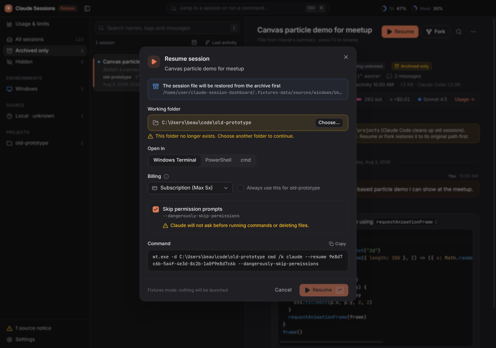             |
| 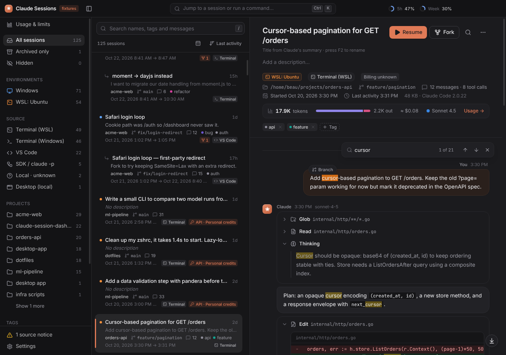                  | 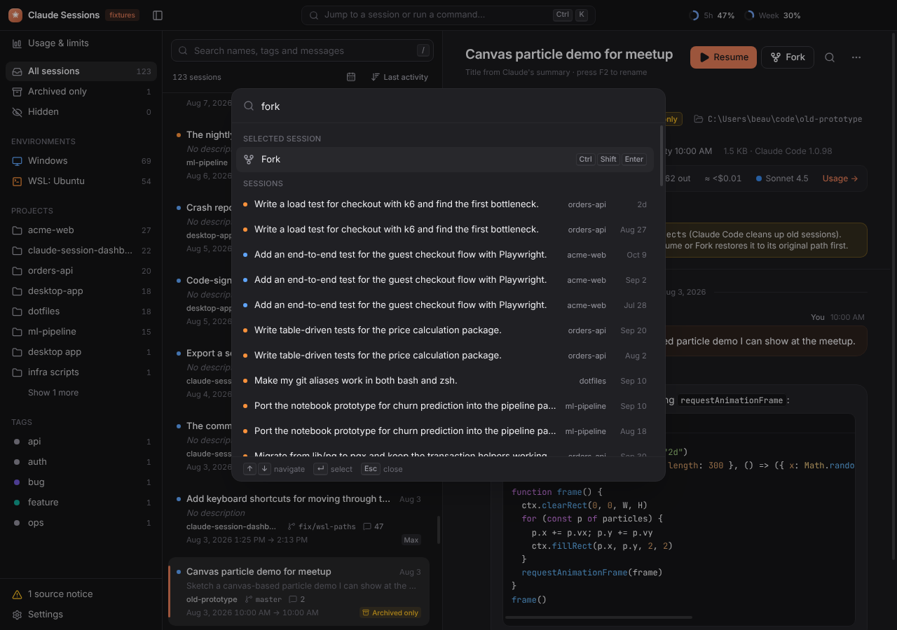         |
| 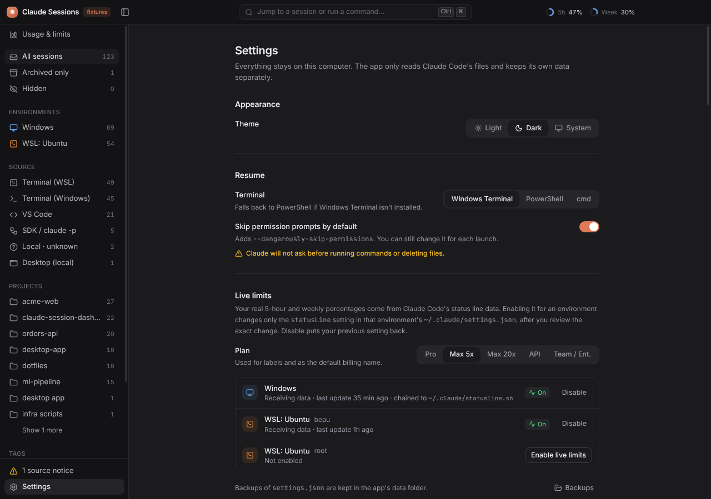                     | 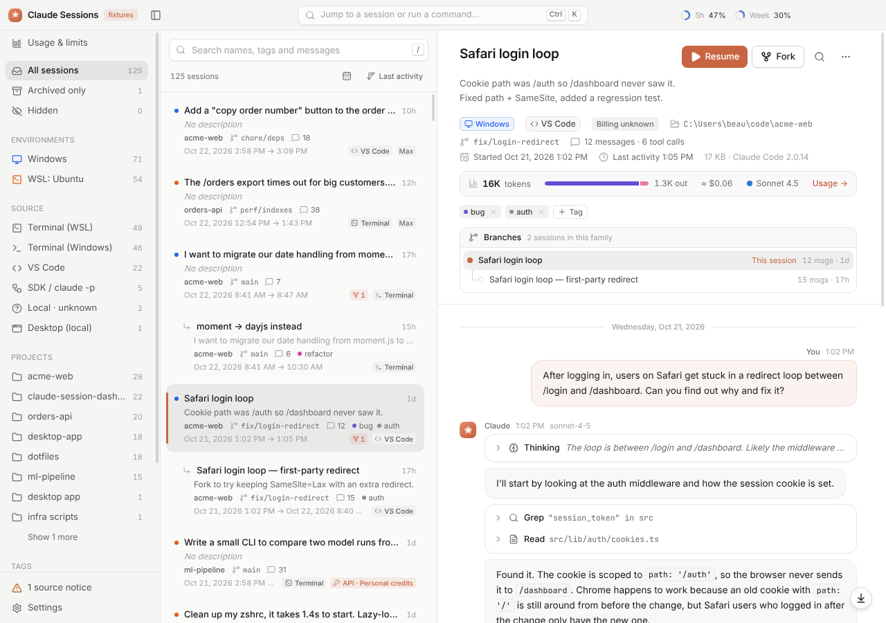                  |
| 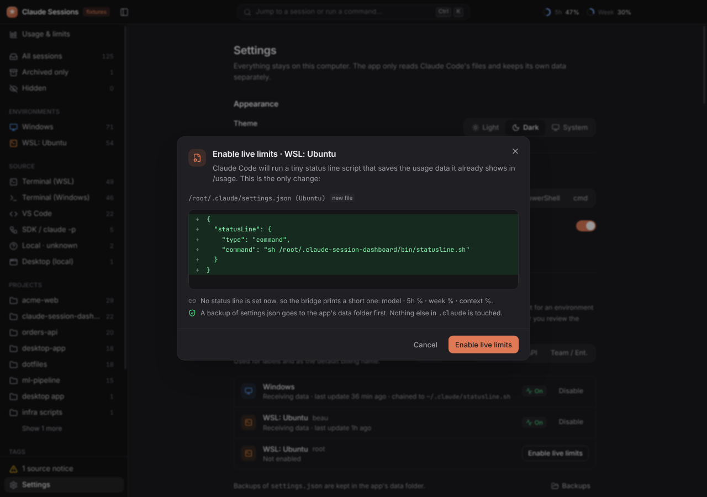 | 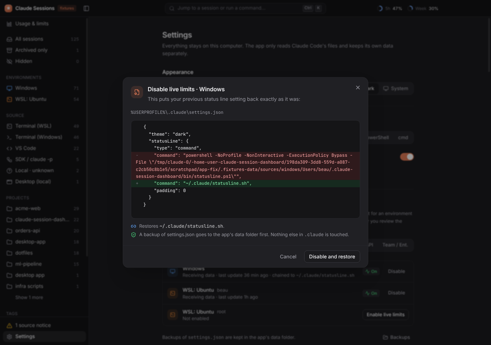 |
| 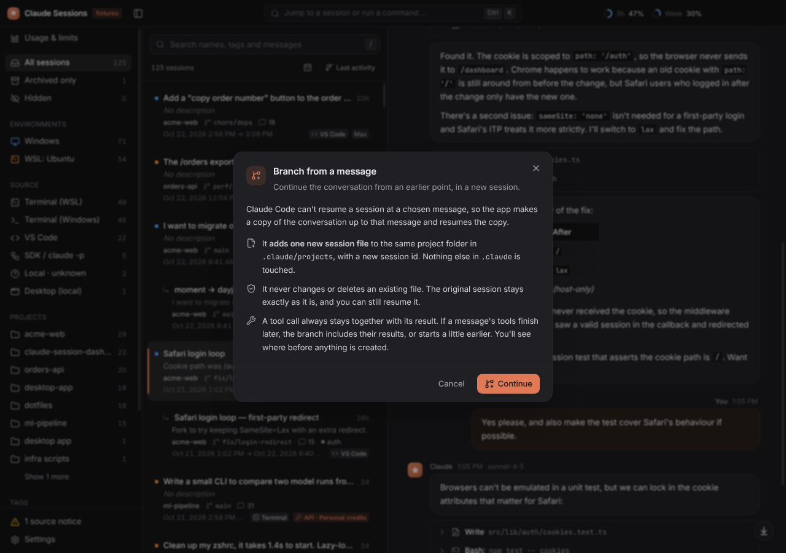    |                        |

## How it works

```
src/
  shared/      Types and pure logic used by both processes: JSONL parsing, titles, Markdown export,
               branch planning (branch.ts) and lineage detection (lineage.ts)
  main/
    core/      Small, tested building blocks: WSL decoding, launch commands, finding programs by
               full path (which.ts), archive, restore, atomic JSON store, write guards
    services/  Source detection, the session catalogue, search index, watcher, launcher
    platform.ts  Everything that touches the OS (wsl.exe, wt.exe, spawn), with a fixtures version
    ipc.ts     The API the window can call (every handler goes through ipc-guard.ts)
  preload/     Exposes that API as window.csd (context isolation, sandboxed)
  renderer/    React UI (Tailwind CSS, shadcn-style components on Radix, lucide icons)
fixtures/      Sample Windows and WSL sessions, including malformed lines and old formats
tests/         Vitest unit and integration tests
```

- **Parsing** is defensive: every line is parsed on its own, and lines that aren't JSON objects are
  skipped and counted (the viewer shows how many). Consecutive assistant lines that share a message
  id are merged, and tool results are attached to their tool calls.
- **The working directory** for resume comes from the `cwd` field in the session's events, never from
  the encoded folder name.
- **WSL:** distros are listed with `wsl.exe -l -q`, whose output is UTF-16LE (decoded, with null bytes
  and blank lines removed). Each distro is read through `\\wsl.localhost\<distro>`, falling back to
  `\\wsl$\<distro>`. Docker Desktop's internal distros are skipped.
- **Live updates:** local folders are watched with chokidar. `\\wsl$` shares don't deliver reliable file
  events, so WSL folders are polled every 10 seconds.
- **Archive:** a session is copied when it's new or has grown. A file that shrank or was rewritten is
  not copied over the archive, so the archive never loses data. Size, SHA-256, original path,
  environment and `cwd` are recorded in `metadata.json`.
- **Storage:** `metadata.json` and `settings.json` are written atomically (temp file, then rename).
  A failed write (a locked file, a full disk) is retried and never blocks later saves, and a junction
  or link can't send a write outside the app's data folder. Search uses MiniSearch (pure JS). A startup cache of
  summaries and the search index means only changed files are re-parsed at launch.

## Decisions and notes

These are choices I made where the spec left room, or had to deviate:

- **No GitHub Actions workflow.** The spec asks for one, but you asked me not to create one (your
  Actions minutes are used up). `npm run check` and `npm run dist` run the same steps locally.
- **TypeScript 6.0.3, not 7.0.2.** 7.0.2 is the newest stable release, but it's the new native
  compiler and the newest `typescript-eslint` (8.72.0) only supports TypeScript below 6.1. Every
  other dependency is the latest stable version, pinned exactly.
- **Phases.** Your message mentioned four phases under "Deliverables" and a "UI / UX design" section,
  but the `CLAUDE.md` I received has neither. I split the work into: (1) scaffold, core parsing and
  safety modules with tests, (2) the main-process services, (3) the UI, and (4) packaging, icon,
  startup cache and docs.
- **Stopped WSL distros** aren't scanned by default, because reading `\\wsl$\<distro>` starts the
  distro. They show as "Not running" with a notice. A setting turns scanning them on.
- **Sessions whose source is offline** (for example, a stopped distro) show their archived copy
  with an "Offline" label rather than disappearing.
- **Choosing a different folder for Resume:** Claude Code looks sessions up by project folder, so
  resuming from a different folder may not find the session. The dialog says so. The app does not
  copy the session into another project folder, because that would mean writing into `.claude`.
- **Copy resume command** copies a **PowerShell** command that opens the same terminal the Resume
  button would (`Start-Process`, in the session's folder). Paste it into PowerShell. The program, its
  arguments and the folder appear only inside single-quoted PowerShell strings, so a folder name
  from a session file can't run anything when pasted. "Copy claude command only" copies just
  `claude --resume …` for pasting into a terminal that's already in the right folder.
- **Renderer libraries are dev dependencies.** Vite bundles them, so only `chokidar` and
  `minisearch` (used by the main process) ship in the installer.
- **Fixtures mode** copies `fixtures/` into `.fixtures-data/` (git-ignored) and runs against that copy.
  Launching only shows the command. To reset the sample data, delete `.fixtures-data/` yourself; the
  app never deletes anything.
- **Code fonts:** JetBrains Mono ligatures are turned off so code shows the characters that are really
  there (`=>` stays `=>`).

### Branching decisions

- **Claude Code can't resume interactively at a message.** I checked `claude --help` (Claude Code
  2.1.309) and the CLI reference (`code.claude.com/docs/en/cli-reference`): `--resume`,
  `--fork-session` and `--session-id` are documented, but nothing resumes at a chosen message. The
  CLI has a _hidden_ `--resume-session-at <message id>` flag, but its own description says it only
  works with `--print` (one non-interactive reply), so it can't open a normal session. `/rewind` and
  double-Esc inside Claude Code work only by hand. So the app uses the fallback: it writes a new
  session file and runs the normal `claude --resume <new id>`.
- **The new file looks like Claude Code's own `/branch` output:** the original lines up to the cut,
  in the same order, with the same message uuids, `sessionId` set to the new id, and a
  `forkedFrom: { sessionId, messageUuid }` marker on each entry. Lines are re-serialised as JSON
  (same content). Summaries and file snapshots that point past the cut, and custom titles, aren't
  copied. Lines that couldn't be parsed are left out. Message and request ids are unchanged, so the
  usage view treats copied responses the way it treats Claude Code's own forks.
- **Where the cut goes:** "Branch from here" keeps the whole message (Claude's message can span
  several lines). On one of Claude's messages that calls tools, the branch keeps going until every
  call has its result, but never into a new prompt or a new reply; otherwise it moves back. A tool
  call that never got a result (a crashed session) is left as it was, since there's nothing to split.
- **The new file goes in the original's project folder** (taken from the original path, even for an
  archived-only session, whose file isn't restored). It's created with an exclusive flag, through a
  write guard that only allows `<uuid>.jsonl` directly in that folder. A stopped WSL distro can't be
  written to, so the dialog says so.
- **Lineage, strongest signal first:** the app's own record (Branch from here, Fork), then
  `forkedFrom` markers, then entries that still carry another session's id (older Claude Code
  copies), then shared history: forks keep the original message uuids, so sessions whose first prompt
  has the same uuid are one family. In a family, a session's parent is the one it shares the most
  messages with. Which of two is the original: the one that stopped where they split; if both went on,
  the one whose file was created first (file birth time, or when the app first archived it). This
  last case is a best guess for forks made outside the app; anything made from the app is exact.
- **Only families are read twice.** Finding the split point needs the message list, so the app reads
  those files (and caches the result); sessions without relatives cost nothing extra.
- **The startup cache format changed (now v3, after merging with the source labels)**, so the
  first start after updating re-reads every session once.
- **Grouping in the list** is on by default and remembered per computer. A family sits where its
  highest-sorted member would be (with the default sort, the most recently active one).
- **Fixtures:** `fixtures/` now includes a `--fork-session` copy of the Safari session and a `/branch`
  copy of the moment migration session (`scripts/make-branch-fixtures.mjs`, which only adds those two
  files). The session counts in the fixtures went from 7 to 9.

### Phase 5 decisions

- **Dates and fixtures clock.** Fixtures mode runs on a clock fixed at the end of the sample data
  (22 Oct 2026, 3:40 PM UTC), so "today", countdowns and trends always look full. The real app uses
  the real clock.
- **The bridge lives in `~/.claude-session-dashboard/`**, next to `.claude` in each environment's home
  (as the spec's `live/` folder does), so the WSL script runs from the Linux file system and stays
  fast. The app writes nothing else outside its data folder.
- **Status line format** was checked against Claude Code's current docs
  (`code.claude.com/docs/en/statusline`): `rate_limits.*.used_percentage` and `resets_at` in epoch
  seconds, `cost.total_cost_usd`, `context_window.used_percentage`. Parsing still accepts epoch
  milliseconds and ISO dates, missing windows and nulls.
- **Windows command uses forward slashes** in the script path, because Claude Code on Windows runs
  status line commands through Git Bash when it's installed, and Git Bash drops backslashes.
- **API billing always opens PowerShell** (not Windows Terminal), because the key can't be passed to
  a new Windows Terminal tab safely. Verified by design rather than on a real Windows Terminal, since
  this was built in a Linux cloud session.
- **Admin API calls use Node's `fetch` in the main process**, so the window's own network block
  stays in place. URLs are built by one function that only allows the two reporting endpoints.
- **Status bar gauges** sit in the title bar, which is the app's existing status area.
- **Tray icon** is drawn by the window (a ring with the 5-hour %) and handed to the tray as a PNG.
- **Colors** were checked with a color-blind-safety validator in both themes: token types are blue
  (cache read), aqua (cache write), violet (input) and pink (output); model families are orange
  (Opus), blue (Sonnet), aqua (Haiku) and violet (Fable), with older versions in lighter shades.
  Red only ever means a limit over 90%.
- **Implied capacity uses one reading per window** (the last, highest one), and skips readings under
  10% (5-hour) or 8% (weekly), which are too coarse.
- **Not detectable from logs:** whether a session ran on API billing. It comes from launch tags and
  the bridge.
- **New dependency:** `recharts` 3.10.1 (latest stable), with `react-is` 19.3.1 as its peer.
- **Price snapshot.** `src/shared/usage/litellm-prices.json` holds LiteLLM's Claude rows (Anthropic
  API rows first, Bedrock's for older models LiteLLM no longer lists directly), in USD per million
  tokens, with the source commit and date. Refresh it by downloading
  `model_prices_and_context_window.json` and running
  `node scripts/make-price-snapshot.mjs <file> <commit> <YYYY-MM-DD>`. Saved price tables keep your
  edits; only the snapshot's fast-mode and long-context prices are added to them. "Reset to snapshot
  prices" brings back the full table.
- **Testing the PowerShell bridge:** `tests/powershell/statusline.Tests.ps1` is a Pester 5 test
  (`Invoke-Pester .\tests\powershell` on Windows). It isn't part of `npm test`, which runs anywhere;
  the `sh` bridge is tested there. Manual check:
  `'{"session_id":"t","model":{"display_name":"Opus"},"rate_limits":{"five_hour":{"used_percentage":12,"resets_at":1738425600}}}' | powershell -NoProfile -File resources\bridge\statusline.ps1`
  should print `Opus · 5h 12%` and create `%USERPROFILE%\.claude-session-dashboard\live\t.json`.

### Limit health, sources and Ask Claude: decisions

- **What came from each reference.** From claude-nerf-watcher: the $-per-1% score, family pricing,
  the median baseline over trusted dates stored per 1x, plan history with multipliers and chart
  markers, the streak flag (threshold 1.5, streak 2), skipping windows under 10%, showing the token
  mix, and backfilling readings from transcripts. From claude-usage-pacer: the cap × elapsed pace
  target, Behind / On pace / Ahead with a tolerance, room per hour, and weekly-first advice. The
  code is our own (TypeScript, on bridge data); `THIRD_PARTY_NOTICES` carries both MIT notices.
- **Family pricing is on by default** because the sample data showed the problem: moving from
  Opus 5 to the cheaper Opus 5.5 alone made the score drop ~25%.
- **Only clear outside usage excludes a window.** The estimated part can't tell usage elsewhere from
  a real cut (both mean local tokens explain less of the %), so excluding on it would hide the very
  thing the detector looks for. It is shown as a warning instead.
- **The sample data stays "Normal"** on purpose: it was generated with a ~25% cut on Oct 1, which
  shows as ~0.8x, above the default flag line (0.67x). Lower the threshold to see it flagged, or
  use Compare (−23%).
- **Source detection** was checked against real Claude Code 2.1 transcripts (`entrypoint`,
  `remote_session_change`) and the CLI's own list of entrypoints. JetBrains runs the plain CLI, so
  it's only recognised when IDE context names the IDE.
- **`/usage` output format**: the "Current session / Current week (all models) … N% used · Resets …"
  panel text; other sections (Sonnet only, extra usage) are ignored. Only real command output is
  read: a `local_command` system line, or the output line Claude Code writes right after the
  `/usage` command it answers. The same panel quoted by Claude, or pasted into a message (even on
  its own), is never taken as a reading.
- **Ask Claude flags** were checked against `claude --help` (2.1.309): `--tools ""` disables every
  built-in tool and `--strict-mcp-config` without `--mcp-config` loads no MCP servers. The runs
  keep their session logs (no `--no-session-persistence`) so their tokens are counted.
  `--safe-mode` and `--setting-sources ""` were added after review: without them your user-level
  CLAUDE.md, auto memory and hooks would have gone along with the previewed text.
- **Subscription check:** `claude auth status` (JSON) reports `apiProvider` and, when an API key
  would be used, `apiKeySource`. Ask Claude runs only for `apiProvider: firstParty` with
  `authMethod` `claude.ai` or `oauth_token` (`claude setup-token`) and no API key. Anything else,
  or an answer it can't read, is refused rather than guessed. A confirmed check is reused for 5
  minutes. Because `auth status` can't skip settings files, a user-level `apiKeyHelper` is refused
  too, even though the question itself wouldn't load it: the safe side for billing.
- **Cancel** works from the moment you click Send and returns at once: while Claude Code is being
  found (which can take up to 20 seconds in WSL), during the subscription check (whose process is
  stopped too), and while the answer is being written. Nothing is started after a cancel.
- **Environment allowlist rather than a blocklist:** a review found that removing named API
  variables missed `ANTHROPIC_CUSTOM_HEADERS`, which can carry another credential. Claude Code
  reads many such variables (gateway tokens, key file descriptors, base URLs), so the environment
  is now built only from what's needed.
- **Implied capacity chart** in the Limit history tab was replaced by the "Used Claude elsewhere"
  list, since the Limit health card supersedes it.
- **The claude.ai importer** has its own small zip reader (Node's zlib), so no new dependency.

## Troubleshooting

- **A WSL distro shows "Can't read".** Open the distro once (for example `wsl -d Ubuntu`), then press
  <kbd>F5</kbd> in the app to rescan.
- **Resume opens a window that closes immediately (WSL).** Check that `claude` works in a login shell:
  `wsl -d <distro> -- bash -lic "claude --version"`.
- **"Claude Code wasn't found on this computer's PATH" (Windows).** The app looks for `claude.exe`,
  `claude.cmd` or `claude.bat` in the folders on `PATH` (never in the project folder). Check that
  `where.exe claude` finds it in a new terminal; if you installed it while the app was open,
  restart the app.
- **The gauges stay empty after enabling live limits.** Send a message in Claude Code (the bridge
  only runs on status line updates), and check that the environment says "Receiving data" in
  Settings → Live limits. `rate_limits` only exists for Pro/Max subscriptions. In WSL, check
  `sh ~/.claude-session-dashboard/bin/statusline.sh < ~/.claude-session-dashboard/live/latest.json`.
- **Nothing shows up.** Open Settings and check the scan sources. Add your `.claude` folder with
  **Add folder…** if it lives somewhere unusual.
