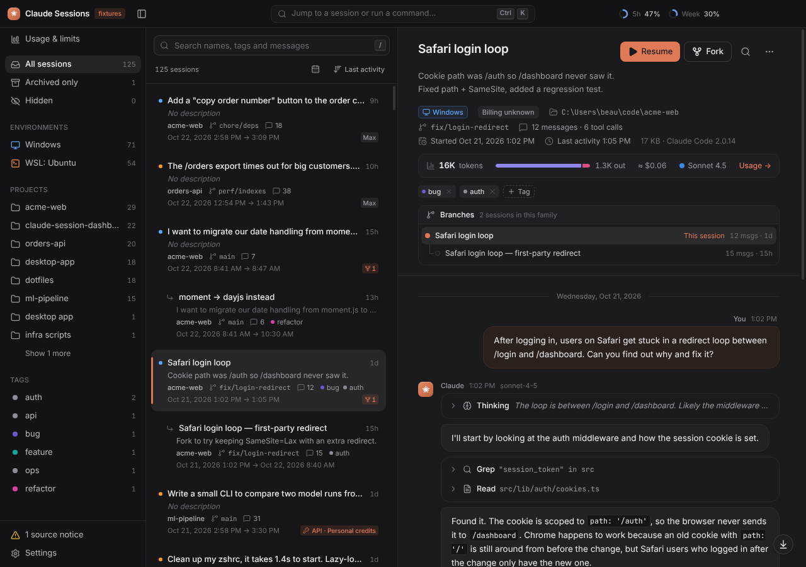
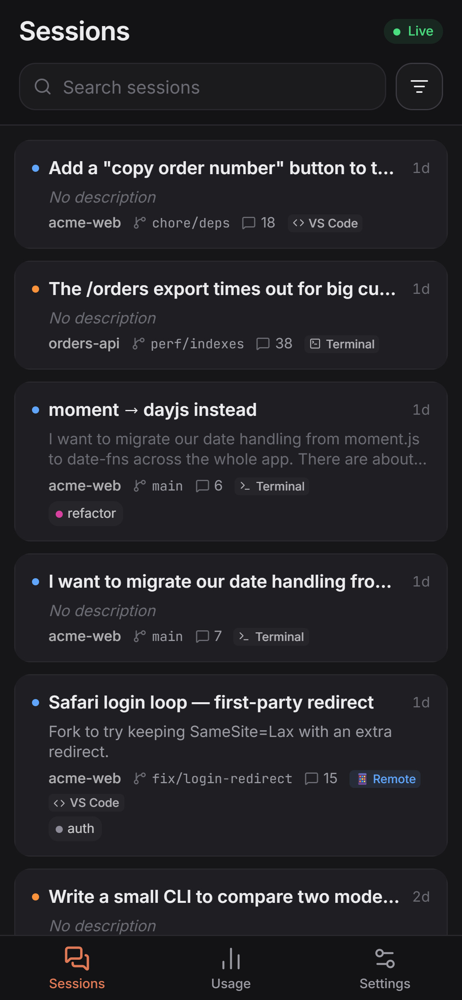
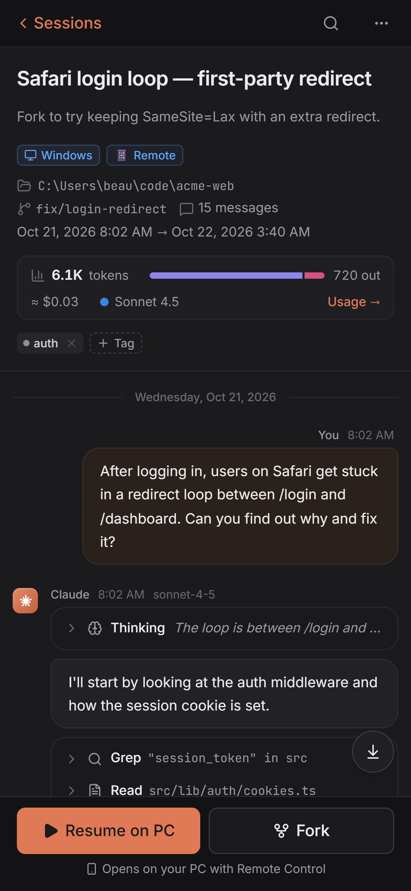
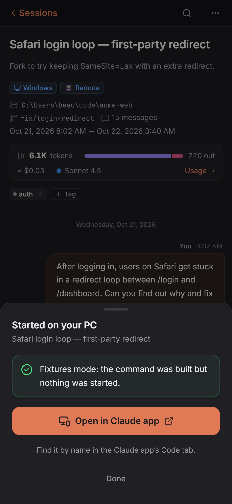
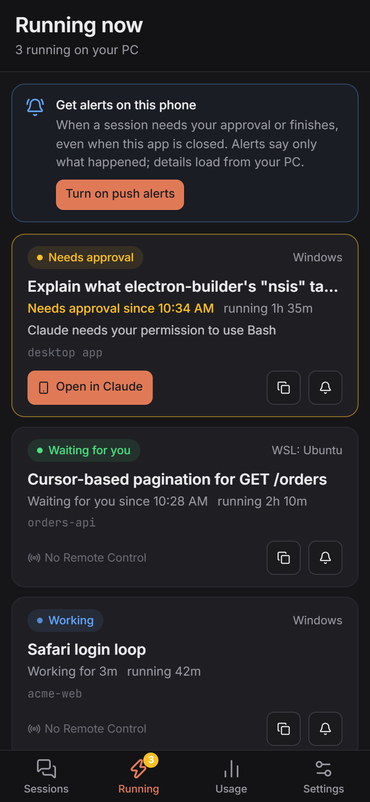
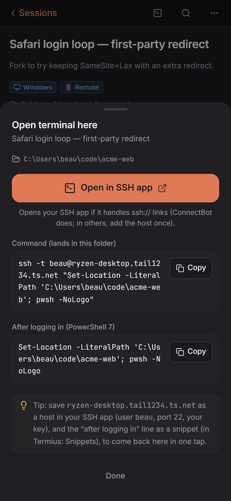
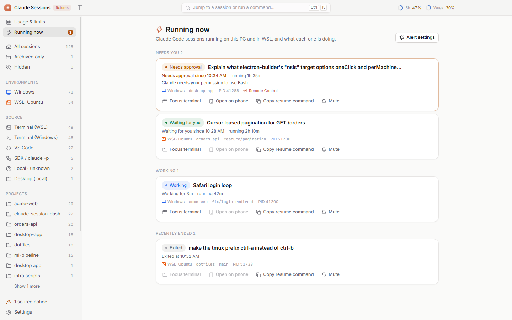

# Claude Session Dashboard

A Windows desktop app that collects every Claude Code session from Windows and WSL in one place. You
can read each session as a conversation, give it your own name, description and tags, keep it
forever in an archive, and resume, fork or branch it in a terminal with its full context. It also
shows your plan limits and token usage, and has a phone companion so you can do the same from your
phone, plus guided setup for a real terminal on your PC from your phone (SSH over Tailscale).
Everything stays on your PC and your own private network.



<table>
  <tr>
    <td></td>
    <td></td>
    <td></td>
    <td></td>
    <td></td>
  </tr>
</table>

## Contents

- [Features](#features)
- [Install](#install)
- [Using it](#using-it)
- [Privacy and safety](#privacy-and-safety)
- [Build from source](#build-from-source)
- [Troubleshooting](#troubleshooting)
- [More details](#more-details)
- [Contributing](#contributing)
- [Author and support](#author-and-support)
- [License](#license)

## Features

### Sessions

- **Every session in one place:** your Windows profile, every WSL distro (each user in `/home`, plus
  `/root`), and any extra folders you add. New and updated sessions show up live.
- **Your own names, descriptions and tags.** Untitled sessions fall back to Claude's summary, then
  to the first message. These live in the app's own data and are never written into Claude's files.
- **Pin and hide** sessions. Hide is only a flag in the app; there is no delete.
- **Full-text search** across names, descriptions, tags and every message, plus filters for project,
  environment, source, tag, date range and hidden sessions.
- **Readable transcripts:** chat bubbles, Markdown, highlighted code, and tool calls and thinking
  blocks collapsed until you click them. Find-in-session and **Export to Markdown**.
- **Copy anything:** Copy buttons on every message, code block and tool call (the full input and
  output, even when the view is shortened), plus **Copy whole conversation** as Markdown. Text can be
  selected and copied normally too, on the PC and on your phone.
- **A permanent archive.** Every session file is copied to the app's data folder, so it survives
  Claude Code's `cleanupPeriodDays` cleanup. Sessions whose original is gone get an "archived only"
  badge.
- **Source labels** show which product ran each session (terminal, VS Code, JetBrains, the desktop
  app, the SDK, or a cloud session).
- **claude.ai conversations:** import a claude.ai data export to read and search those
  conversations next to your sessions (view only).

### Resume, fork and branch

- **Resume** opens the session in Windows Terminal (or PowerShell / cmd) in the right folder, for
  Windows and WSL sessions alike. **Fork** adds `--fork-session` so the original stays untouched.
- If the session file was cleaned up, Resume first puts the archived copy back (it never overwrites
  a file). If the working folder is gone, it asks you for another one.
- **Branch from any message:** continue the conversation from that point in a new session. A
  **Branches** panel shows the family tree, and the list can group branches under their parent.
- **Remote Control:** start the session with `--remote-control` so you can carry on in the Claude
  app or at claude.ai/code. These sessions get a **📱 Remote** badge that links straight to them.
- `--dangerously-skip-permissions` is on by default, with a per-launch checkbox and a warning label.
  **Copy resume command** lets you paste it yourself.
- **Billing per launch:** run any session on your subscription or on an API key.
- **Model and effort per session:** pick the model (an alias like `opus`, a model seen in your
  logs, or any model ID) and the effort level. Every launch adds `--model` / `--effort`; Default
  adds nothing, so Claude Code decides.

### Summaries and Continue fresh

- **A summary per session:** what was done, files changed, decisions, open to-dos and where to pick
  up, at the top of the viewer and as one line on each card. Written by Claude through your own
  Claude Code on your subscription, only when you ask (one session, or **Summarize selected**), or
  automatically for big idle sessions if you turn that on. Editable, regenerable, searchable, and
  kept only in the app's data.
- **Continue fresh** starts a new session in the same folder from the summary instead of reloading
  the whole history, which is much lighter on your 5-hour window. It uses the same options as Resume
  and shows in the Branches panel as "continued from".
- **Limits guard:** Summarize selected shows the tokens and roughly how much of your 5-hour window
  it would use first, and pauses (with a Resume button) if the live 5-hour limit goes above 80%.
  Summary runs show in Usage as "Summaries (dashboard)".

### Usage and limits

- **Live limits:** your real 5-hour and weekly plan percentages (the same ones `/usage` shows), with
  reset countdowns, pacing and alerts at 75% and 90%. This uses a small, opt-in status line bridge.
- **Every token, forever:** usage by day, model, session, project, environment and source, read from
  your logs and the archive. Charts, a raw table and CSV export.
- **API credits:** track credit grants, spending, burn rate and how long they will last. With an
  Admin key, pull your organization's usage and cost reports.
- **Limit health:** checks whether each 1% of your plan still buys as much work as it used to.
- **Trends** per model and Claude Code version ("is it nerfed?"), and a limit history.
- **Ask Claude** about your usage ("Have my limits dropped?") through your own Claude Code, on your
  plan. Only aggregated numbers are sent, and you see them first.
- **At a glance:** gauges in the title bar, a tray icon with the 5-hour %, and an always-on-top mini
  meter.

### Running now and session alerts



- **Running now** (sidebar, with a count badge, and a section at the top of the session list): every
  Claude Code session that's running on Windows and in WSL, with its state: **Working**, **Needs
  approval**, **Waiting for you** (finished, ready for your next message) or **Exited**, plus how
  long it has been running and "waiting for you since …".
- **Focus terminal** brings the session's Windows Terminal window forward and selects its tab (found
  by the session's name), **Open on phone** shows a QR code of its Remote Control link, and **Copy
  resume command**.
- **Alerts** when a session needs your approval or finishes: Windows notifications, and **push
  alerts on your phone** (opt-in per phone). Pick which events alert, set quiet hours, and mute single
  sessions.
- Works without any setup from Claude Code's own session files. **Enable session alerts** for exact,
  instant states: it adds a few hooks to Claude Code's `settings.json`, after you review the diff.

### Backups

- **Back up everything the app keeps** (the archive, your names, descriptions and tags, usage and
  limit history, and its settings) to a folder you choose, such as OneDrive, an external drive or a
  NAS. Your cloud app syncs it; the dashboard makes no network calls.
- **Daily or weekly** while the app is open, plus **Back up now**. Only new or changed files are
  copied (compressed), and it keeps the last 14 snapshots (you choose how many).
- **Optional password** (AES-256). Remember it on this PC, or enter it once per start. API keys are
  never in a backup.
- **Restore** any snapshot: you see what would change first, it only ever writes to the app's own
  data folder (never `.claude`), and it keeps a copy of every file it replaces.

### Phone companion

- The same app in a phone layout: search and read sessions, rename, describe, tag, pin and hide
  them, and check usage and limits. It updates live and installs to your home screen.
- **Resume, fork, branch or continue fresh** a session on your PC from the phone, with Remote
  Control on, then continue it in the Claude app. Summaries show on the phone and can be edited
  there (they are written on the PC).
- Connect over **Tailscale** (private, works from anywhere) or **home Wi-Fi only**. Each phone is
  paired with a QR code and has its own key, which you can revoke.
- A phone **can't** run any other command, change security or pairing settings, see API keys, use
  Ask Claude or write summaries. Phone launches always use your subscription and keep permission prompts on.
- Optional read-only mode, confirm-on-PC for launches, and an activity log of every phone action.
- **Running now** on the phone too, with push alerts that work when the app is closed. A push says
  only what happened ("A session needs your approval"); tapping it loads the details from your PC.

### Terminal access (SSH)

- **A real terminal on your PC from your phone**, through Windows' own OpenSSH Server, over
  Tailscale only. A wizard sets it up step by step and shows every change before it runs; each
  change can be undone, and **Turn off terminal access** undoes them all.
- **Open terminal here** on every session and project: on the PC it opens a terminal in that folder;
  on the phone it gives an `ssh://` link and a copyable `ssh` command that lands in the folder (for
  PowerShell or WSL).
- **Keys made easy:** paste your SSH app's public key, or send it from the dashboard on your phone
  (**Send SSH key to PC**) and approve it on the PC after comparing fingerprints. Then turn password
  login off with one click (backed up, with Undo).
- Works with any SSH app: the wizard links Termius (free plan) on iPhone and Android, and the free
  a-Shell (iPhone) and ConnectBot (Android), and shows the PC's host-key fingerprints to check on
  first connect.

### Guided setup and help

- **Every connection has a setup wizard with live checks** (✓ / ✗ at each step): **Connect your
  phone** (Tailscale or home Wi-Fi, pairing by QR code, Remote Control check) and **Terminal
  access** (OpenSSH, firewall, shell, keys, phone app, test).
- **Troubleshooting** panels list the common fixes, re-run every check and copy diagnostics with no
  secrets in them.
- **Copy AI help prompt:** paste it into Claude or another AI assistant to get help with a
  connection. It points the assistant at [`docs/AI-SETUP-GUIDE.md`](docs/AI-SETUP-GUIDE.md), which
  tells it to start with read-only checks, ask you before any change, and never ask for secrets.

## Install

You need Windows 10 or 11 (64-bit). Claude Code must already be installed for Resume, Fork and
Remote Control.

> The repository is private for now. You need to be added as a collaborator to see it and its
> releases.

1. Open [Releases](https://github.com/Beaulewis1977/claude-session-dashboard/releases) and download
   the latest `ClaudeSessionDashboard-Setup-<version>.exe` (currently
   [v1.1.0](https://github.com/Beaulewis1977/claude-session-dashboard/releases/tag/v1.1.0)). There is
   also a `-Portable-` exe that runs without installing.
2. Run it. The installer isn't code-signed yet, so SmartScreen may say "Windows protected your PC".
   Click **More info**, then **Run anyway**.
3. It installs for your user only (no administrator rights needed), and you can pick the folder.

**Updating:** run the newer installer over the old one. Your names, tags, archive, settings, paired
phones and API keys are kept, because they live in `%APPDATA%\ClaudeSessionDashboard\`. The app
never updates itself (it makes no network calls), so check Releases for new versions. Your version
is in Settings → About.

**Uninstalling:** Windows Settings → Apps → Claude Session Dashboard → Uninstall. This removes the
program only. To remove its data and archive too, delete `%APPDATA%\ClaudeSessionDashboard\`. If you
use the phone companion, turn off Settings → Phone first so the app removes its Tailscale (or
firewall) rule. Your `.claude` folders are never touched.

## Using it

### First launch

The app finds your Windows and WSL sessions on its own and lists them, newest activity first. If a
WSL distro isn't running, it shows a notice instead of starting it. Add any other `.claude` folder
under Settings → Scan sources → **Add folder…**.

### Name, describe and tag

Click the title or description at the top of a session (or press <kbd>F2</kbd>, <kbd>D</kbd> or
<kbd>T</kbd>). Changes save when you leave the field. Use ⋯ → **Pin to top** to keep a session at the
top.

### Resume, fork and branch

- Press <kbd>Ctrl</kbd>+<kbd>Enter</kbd> to resume, or <kbd>Ctrl</kbd>+<kbd>Shift</kbd>+<kbd>Enter</kbd>
  to fork. The dialog shows the exact command, whether the file will be restored from the archive,
  and whether the working folder still exists.
- To branch, hover a message and click **Branch** (or right-click it). The first time, the app
  explains that it adds one new session file and asks you to confirm.
- Tick **Remote Control** in the dialog (or turn it on by default in Settings → Resume) to continue
  the session in the Claude app or at claude.ai/code. It needs Claude Code 2.1.51 or later, signed in
  with your Claude subscription.
- **Model and effort:** choose them under the session's title ("Launch with") or in the launch
  dialog. They're saved for that session; Default falls back to the project's default (⋯ **Project
  default** next to the pickers), then Settings → Resume, then Claude Code's own choice. The Resume
  button shows the result ("Resume · Opus · High"). If you set `CLAUDE_CODE_EFFORT_LEVEL`, Claude
  Code uses it instead of `--effort`.

### Connect your phone

Settings → **Phone** → **Connect your phone…** walks you through it and checks each step:

1. Install **Tailscale** on the PC (**Install for me** runs winget after you confirm).
2. Sign in to Tailscale on the PC.
3. Install Tailscale on your phone, sign in with the same account and leave the VPN on.
4. **Turn on phone access.** If your tailnet doesn't have HTTPS certificates yet, click **Turn on
   HTTPS**, then **Try again**.
5. **Show pairing code**, scan the QR code with your phone's camera and tap **Pair this phone**.
6. **Send test** to check it works, then add the app to your home screen (Share → Add to Home Screen
   on iPhone, Install app on Android).

No Tailscale? Choose **Home Wi-Fi** in the wizard: pick the PC's network address, approve the
firewall rule and pair. Your phone must be on the same Wi-Fi.

### Set up terminal access

Settings → **Terminal access (SSH)** → **Set up terminal access…**. Each step checks itself,
and each change shows the exact script first; Windows then asks for administrator rights.

1. **Tailscale connected** on the PC (and on your phone).
2. **OpenSSH Server:** **Install for me**.
3. **Firewall:** add the Tailscale-only rule and turn off Windows' default rule that allows SSH from
   any address, then **start sshd** (it only starts once nothing outside Tailscale can reach it).
4. **Default shell:** PowerShell 7, Windows PowerShell or WSL (your default distro).
5. **Keys:** in your SSH app, create a key and copy its _public_ key. Paste it here, or click **Get
   key from phone** and send it from the dashboard on your phone (Settings → Send SSH key to PC),
   then check the fingerprint and click **Allow**. Log in once with the key, then **Turn off
   password login** (sshd_config is backed up first).
6. **Phone app:** Termius (free plan) on iPhone or Android, or the free a-Shell (iPhone) and
   ConnectBot (Android). Add a host with the host name, user and port shown.
7. **Test:** connect from the phone; the step turns ✓ when sshd records the login.

**Turn off terminal access** undoes exactly what the wizard changed (and, if you tick them, removes
the keys it added and uninstalls OpenSSH Server if it installed it). The **Change log** lists every
change.

### Turn on live limits

1. Open Settings → **Live limits** (or click **Enable live limits** on the Usage view).
2. Pick your plan.
3. Click **Enable live limits** next to each environment you use (Windows, and each WSL user).
4. Check the diff the dialog shows, then confirm. Your current status line keeps working.
5. Send any message in Claude Code. The gauges fill in after its next status line update.

**Disable** in the same place puts your previous `statusLine` back exactly.

### Turn on session alerts

1. Open Settings → **Session alerts**.
2. Click **Enable session alerts** next to each environment you use (Windows, and each WSL user).
3. Check the diff: the app's hooks are added at the end of each event's list, and your own hooks stay
   exactly as they are. Confirm.
4. Sessions started or resumed from now on send their events. Pick which events alert, and quiet
   hours, in the same section.
5. On each phone that should get alerts: Running now → **Turn on push alerts** (on an iPhone, add the
   app to the Home Screen first and open it from there).

**Disable** takes out exactly the app's hooks. Your other hooks stay as they are.

### Set up backups

1. Open Settings → **Backup** and click **Choose folder…** (for example a folder in OneDrive, or on an
   external drive). The app creates a `ClaudeSessionDashboard Backup` folder there and writes only
   inside it.
2. Choose whether to encrypt with a password (recommended for a cloud folder: backups hold your full
   session transcripts). **If you lose the password, the backups can't be read.** Tick **Remember on
   this PC** so scheduled backups run without asking.
3. Pick **Daily** or **Weekly** and how many snapshots to keep, or click **Back up now**.

**To restore** (also on a new PC: install the app, then choose the same backup folder): Settings →
Backup → **Restore…**, pick a snapshot, check what would change, then **Restore and restart**. Files
that aren't in the snapshot stay, archived sessions are never replaced by an older (smaller) copy,
and the files it replaces are kept in `%APPDATA%\ClaudeSessionDashboard\restore-backups\`.

### Summarize and continue fresh

- Click **Summarize** at the top of a session (or right-click it in the list). The first time, the
  app shows what is sent and asks before sending: the conversation's text and one line per tool call
  (never tool output, thinking or images), with common secrets masked, cut to 120,000 characters
  keeping the start and the end. **Show exactly what is sent** shows the full text.
- To summarize many at once, pick them with <kbd>Ctrl</kbd>+click or <kbd>Shift</kbd>+click and
  click **Summarize selected**. You see the estimate first; a panel in the corner shows progress,
  and Cancel stops it.
- **Continue fresh** (on the summary, or ⋯ → **Continue fresh from summary…**) opens the launch
  dialog with the handoff it will start from. The summary is written to a file in the app's data
  folder, and the new session's first message points Claude Code at it.
- Settings → Summaries: the model (Sonnet by default), the size limit, the pause line and
  auto-summarize (off by default).

### Keyboard shortcuts

| Keys                                              | Action                  |
| ------------------------------------------------- | ----------------------- |
| <kbd>Ctrl</kbd>+<kbd>K</kbd>                      | Command palette         |
| <kbd>/</kbd>                                      | Search                  |
| <kbd>J</kbd> / <kbd>K</kbd>                       | Next / previous session |
| <kbd>Ctrl</kbd>+<kbd>Enter</kbd>                  | Resume                  |
| <kbd>Ctrl</kbd>+<kbd>Shift</kbd>+<kbd>Enter</kbd> | Fork                    |
| <kbd>F2</kbd> / <kbd>D</kbd> / <kbd>T</kbd>       | Rename / describe / tag |
| <kbd>Ctrl</kbd>+<kbd>F</kbd>                      | Find in session         |
| <kbd>Ctrl</kbd>+<kbd>U</kbd>                      | Usage and limits        |
| <kbd>Ctrl</kbd>+<kbd>,</kbd>                      | Settings                |
| <kbd>F5</kbd>                                     | Rescan                  |
| <kbd>?</kbd>                                      | Every shortcut          |

## Privacy and safety

The full rules are in [`CLAUDE.md`](CLAUDE.md). In short:

- **It never deletes or changes anything in a `.claude` folder.** It only reads. The one built-in
  exception: when you resume a session whose file is missing, it copies the archived copy back, and
  it can never overwrite a file. **Branch from here** only ever adds one new session file.
- **Its own data** lives only in `%APPDATA%\ClaudeSessionDashboard\`, plus, if you turn on backups,
  the one backup folder you pick (the app writes and deletes only inside its own subfolder there).
- **There is no delete.** Hide is only a flag.
- **No network calls.** Outgoing requests from the window are blocked, remote images in
  transcripts aren't loaded, and spellcheck is off. Ask Claude and summaries go to Claude only
  through your own Claude Code (`claude -p`), on your subscription, after showing you what is sent.

Six opt-in exceptions, each only after you approve it in the app:

1. **Live limits** changes only the `statusLine` key in Claude Code's `settings.json`. You see the
   diff first, the file is backed up, and Disable restores the old value exactly.
2. **Admin API keys** let the app call two read-only reporting endpoints on `api.anthropic.com`
   (usage and cost). Never any session content. Standard keys cause no network calls.
3. **The phone companion** is off by default. It listens on `127.0.0.1` and is published to your own
   tailnet only (never the public internet), or, in home Wi-Fi mode, on one private address behind a
   firewall rule you approve.
4. **Terminal access** changes Windows' SSH setup (OpenSSH Server, one firewall rule limited to
   Tailscale, the default shell, your key, and optionally password login). Each change shows its
   exact script first, is logged, and can be undone; your existing keys and settings are never
   removed. The dashboard never runs commands for the phone: Windows' OpenSSH does the logins.
5. **Session alerts** add the app's hooks to the `hooks` key in Claude Code's `settings.json`
   (appended, never replacing yours). You see the diff first, the file is backed up, and Disable
   takes out exactly the app's hooks. The hook script only saves each event in the app's own
   `~/.claude-session-dashboard/events` folder.
6. **Phone push alerts** are off until you turn them on, on each phone. The PC then sends an
   end-to-end encrypted Web Push message to that phone's browser push service (Google, Apple,
   Mozilla or Microsoft), which can't read it. It holds only the kind of alert and a random
   reference: no session names, folders or text. Nothing else leaves the PC.

API keys are encrypted with Windows (DPAPI) and never shown, logged or put on a command line. See
[More details](docs/DETAILS.md#safety-in-full) for the full list.

## Build from source

You need **Node.js 22.12 or newer** and **Git**. No Visual Studio or build tools are needed: the
project uses no native Node modules.

```powershell
git clone https://github.com/Beaulewis1977/claude-session-dashboard.git
cd claude-session-dashboard
npm install
npm run dev                  # run with hot reload
npm run dev -- --fixtures    # run with the sample sessions in fixtures/
npm run check                # typecheck, lint, tests and build
npm run dist                 # build the installer and portable exe into release\<version>\
```

Run the tests from **Git Bash**: a few of them call `sh` / `bash`, which PowerShell doesn't find.

**Making your own fork:** change `appId` and `productName` in `electron-builder.yml` (and `name` /
`productName` in `package.json`) so your build installs next to this one instead of replacing it.

**Making a release** (built on a Windows PC, uploaded with `gh`; there is no CI):

1. Update `CHANGELOG.md` and run `npm version <x.y.z> --no-git-tag-version`, then merge to `main`.
2. On an up-to-date `main`, run `npm ci`, `npm run check` and `npm run dist`.
3. Upload both exes:
   ```powershell
   gh release create v<x.y.z> --target main --title "v<x.y.z>" --notes-file <notes.md> `
     "release\<x.y.z>\ClaudeSessionDashboard-Setup-<x.y.z>.exe" `
     "release\<x.y.z>\ClaudeSessionDashboard-Portable-<x.y.z>.exe"
   ```
4. Install the new setup file over the old one to check it.

See [More details](docs/DETAILS.md#scripts) for every script and how the code is organised.

## Troubleshooting

- **Phone or SSH connection not working?** Open Troubleshooting in Settings → Phone (or Terminal
  access) and click **Copy AI help prompt**, then paste it into Claude or another AI assistant. It
  points the assistant at [`docs/AI-SETUP-GUIDE.md`](docs/AI-SETUP-GUIDE.md): read-only checks first,
  your OK before any change, and no secrets.
- **Nothing shows up.** Check the scan sources in Settings. Add your `.claude` folder with **Add
  folder…** if it lives somewhere unusual.
- **A WSL distro shows "Can't read".** Open the distro once (for example `wsl -d Ubuntu`), then press
  <kbd>F5</kbd> to rescan.
- **Resume opens a window that closes at once (WSL).** Check that `claude` works in a login shell:
  `wsl -d <distro> -- bash -lic "claude --version"`.
- **"Claude Code wasn't found on this computer's PATH".** Check that `where.exe claude` finds it in a
  new terminal. If you installed it while the app was open, restart the app.
- **The gauges stay empty after enabling live limits.** Send a message in Claude Code, then check
  that the environment says "Receiving data" in Settings → Live limits. Live limits only exist for
  Pro and Max subscriptions.
- **The phone can't connect.** Settings → Phone → **Troubleshooting** re-runs every check. Usual
  causes: the Tailscale switch is off on the phone, HTTPS certificates are off for the tailnet, or
  (home Wi-Fi) Windows treats the network as Public.
- **SmartScreen blocks the installer.** Click **More info**, then **Run anyway**. The exe isn't
  code-signed yet.

## More details

[docs/DETAILS.md](docs/DETAILS.md) has the deep material: the full safety rules, how launch commands
are built, branching, what a phone can and can't do, what every usage number means, matching
ccusage, where the data lives, how the code is organised, and the decisions behind the app. The
original usage-tracking spec is in [docs/PHASE-5-USAGE-TRACKING.md](docs/PHASE-5-USAGE-TRACKING.md),
and release notes are in [CHANGELOG.md](CHANGELOG.md).

## Contributing

This is currently a personal project, but issues and PRs are welcome. If you open a PR, please:

- Fork the repository and branch from `main`.
- Read [`CLAUDE.md`](CLAUDE.md) first and keep to its safety rules (never modify `.claude`, no
  network calls, no native Node modules).
- Follow the existing conventions (TypeScript, function components, ESM imports, two-space indent,
  single quotes, no semicolons). `npm run format` applies Prettier.
- Add tests for new behavior and never weaken existing tests.
- Run `npm run check` (from Git Bash) before pushing, then open a PR to `main`.

## Author and support

**Designed and built by Beau Lewis**
📧 [BLewisxx@gmail.com](mailto:BLewisxx@gmail.com)

If Claude Session Dashboard helps you and you'd like to support more projects like this, any
contribution is hugely appreciated and goes directly toward building more tools that help real
people:

<p align="left">
  <a href="https://venmo.com/u/beauintulsa"></a>
  &nbsp;
  <a href="https://ko-fi.com/beaulewis"></a>
</p>

- **Venmo:** [@beauintulsa](https://venmo.com/u/beauintulsa)
- **Ko-fi:** [ko-fi.com/beaulewis](https://ko-fi.com/beaulewis)

Thank you for checking out Claude Session Dashboard. 💚

## License

Released under the **MIT License**. See [`LICENSE`](LICENSE) for details.
