# Claude Session Dashboard

[](https://github.com/Beaulewis1977/claude-session-dashboard/releases/latest)
[](LICENSE)
[](#requirements)

A Windows desktop app that gathers every Claude Code and OpenAI Codex session on your PC, from
Windows and from WSL, into one searchable place. Read each session as a conversation, give it your
own name, keep it forever, and pick it up again in the right terminal with one click. It also shows
your live plan limits and token usage, alerts you when a session needs you, answers questions about
your whole history, and has a phone companion. Everything stays on your PC and your own private
network.

- **Every session, kept forever:** Claude Code, Codex and Claude desktop, Windows and WSL, with
  your own names, tags and full-text search, even after Claude Code deletes old sessions.
- **Resume, fork, branch or continue fresh** in Windows Terminal, the Claude desktop app or the
  Codex app, with the right folder, model and effort.
- **Live limits and usage:** your real 5-hour and weekly percentages for Claude and Codex, with
  pacing, every token you've used, and costs.
- **A nerf detector:** checks whether each 1% of your plan still buys as much work as it used to,
  tracks model behavior week by week, and compares any two periods or versions.
- **Ask across all sessions:** "Where did I fix the WSL path bug?", answered with citations that
  open the exact message.
- **Running now, alerts and your phone:** see which session needs approval, get a notification on
  your PC or phone, and continue from the phone.

<picture>
  <source media="(prefers-color-scheme: dark)" srcset="docs/images/main-dark.webp">
  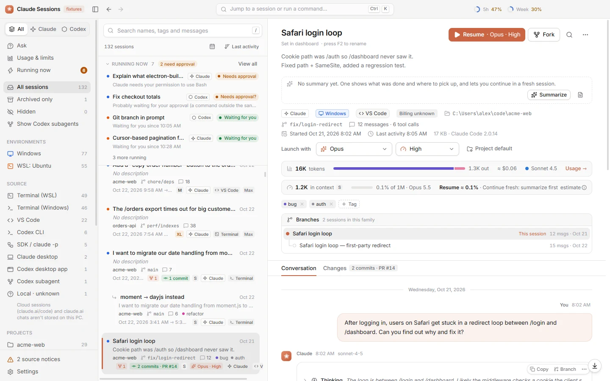
</picture>

<sub>All screenshots use the sample data in `fixtures/` (fixtures mode), never real sessions.</sub>

## Contents

- [Quick start](#quick-start)
  - [Requirements](#requirements) · [Install](#install) · [First run](#first-run) ·
    [Build from source](#build-from-source)
- [Features](#features)
  - [Browse and read sessions](#browse-and-read-sessions): [where sessions come from](#where-sessions-come-from),
    [the session list](#the-session-list), [names, descriptions and tags](#names-descriptions-and-tags),
    [search and filters](#search-and-filters), [the viewer](#the-viewer),
    [pick several sessions](#pick-several-sessions), [back and forward](#back-and-forward),
    [the archive](#the-archive)
  - [Resume, fork, branch and continue](#resume-fork-branch-and-continue): [resume and fork](#resume-and-fork),
    [model and effort](#model-and-effort), [skip permission prompts](#skip-permission-prompts),
    [Remote Control](#remote-control), [Open in Claude desktop app](#open-in-claude-desktop-app),
    [Open in Codex app](#open-in-codex-app), [branch from any message](#branch-from-any-message),
    [context size warnings](#context-size-warnings),
    [no duplicate terminals](#no-duplicate-terminals), [billing per launch](#billing-per-launch)
  - [Summaries and Continue fresh](#summaries-and-continue-fresh)
  - [Ask across all sessions](#ask-across-all-sessions): [local questions](#local-questions),
    [content questions](#content-questions), [the preview](#the-preview),
    [citations](#citations), [model and effort for answers](#model-and-effort-for-answers)
  - [Running now and alerts](#running-now-and-alerts): [states](#session-states),
    [session alerts (hooks)](#session-alerts-hooks), [desktop notifications](#desktop-notifications),
    [phone push alerts](#phone-push-alerts)
  - [Usage and limits](#usage-and-limits): [live limits](#live-limits), [pacing](#pacing),
    [token usage and costs](#token-usage-and-costs), [Codex usage and limits](#codex-usage-and-limits),
    [at a glance: title bar, tray and mini meter](#at-a-glance-title-bar-tray-and-mini-meter),
    [API credits](#api-credits), [Ask Claude about your usage](#ask-claude-about-your-usage)
  - [Nerf detector: limit health and trends](#nerf-detector-limit-health-and-trends):
    [the score](#the-score-dollars-per-1), [your baseline and plans](#your-baseline-and-plans),
    [the verdict](#the-verdict), [where your limits went](#where-your-limits-went),
    [limit history](#limit-history), [trends](#trends), [compare](#compare),
    [keeping it honest](#keeping-it-honest)
  - [Git links](#git-links)
  - [Phone companion](#phone-companion)
  - [Terminal access from your phone](#terminal-access-from-your-phone)
  - [Backup and restore](#backup-and-restore)
  - [Providers and settings](#providers-and-settings)
- [Keyboard shortcuts](#keyboard-shortcuts)
- [Privacy and safety](#privacy-and-safety)
- [FAQ and troubleshooting](#faq-and-troubleshooting)
- [Updating, versions and contributing](#updating-versions-and-contributing)
- [Author and support](#author-and-support) · [License](#license)

More depth: [docs/DETAILS.md](docs/DETAILS.md) (how everything works),
[CHANGELOG.md](CHANGELOG.md) (what changed in each version) and
[docs/AI-SETUP-GUIDE.md](docs/AI-SETUP-GUIDE.md) (for an AI assistant helping you connect a phone).

---

## Quick start

### Requirements

| What                                                         | Needed for                                                             |
| ------------------------------------------------------------ | ---------------------------------------------------------------------- |
| **Windows 10 or 11** (64-bit)                                | Running the app                                                        |
| **Claude Code** and/or **OpenAI Codex** CLI                  | Resume, Fork, summaries and Ask (reading sessions works without them)  |
| **WSL** (optional)                                           | Sessions you run inside WSL distros                                    |
| **Tailscale** (optional)                                     | The phone companion from anywhere, and terminal access from your phone |
| **Windows Terminal** (optional)                              | The preferred terminal; PowerShell or cmd are used otherwise           |
| **Node.js LTS** (22.12 or newer; 24 recommended) and **Git** | Only for building from source                                          |

Remote Control needs Claude Code 2.1.51 or newer, signed in with a Claude subscription. Open in
Claude desktop app needs Claude Code 2.1.285 or newer.

### Install

1. Open [the latest release](https://github.com/Beaulewis1977/claude-session-dashboard/releases/latest)
   and download `ClaudeSessionDashboard-Setup-<version>.exe`. There is also a
   `ClaudeSessionDashboard-Portable-<version>.exe` that runs without installing.
2. Run it. The installer isn't code-signed, so SmartScreen may say "Windows protected your PC":
   click **More info**, then **Run anyway**.
3. It installs for your user only (no administrator rights needed), and you can pick the folder.

### First run

1. **Start the app.** It finds your sessions on its own: your Windows profile, every running WSL
   distro (each user in `/home`, plus `/root`), and your `.codex` folders. They show up newest
   first and update live.
2. **Something missing?** Settings → **Scan sources** → **Add folder…** for a `.claude` or `.codex`
   folder in an unusual place. A stopped WSL distro shows a notice instead of being started.
3. **Optional, one at a time, each with a preview of exactly what changes:**
   - Settings → **Live limits** → **Enable live limits** for your real 5-hour and weekly gauges
     ([how](#live-limits)).
   - Settings → **Session alerts** → **Enable session alerts** for instant "needs approval" and
     "finished" alerts ([how](#session-alerts-hooks)).
   - Settings → **Backup** → **Choose folder…** to keep a copy of everything the app keeps
     ([how](#backup-and-restore)).
   - Settings → **Phone** → **Connect your phone…** ([how](#phone-companion)).
4. Press <kbd>?</kbd> for every keyboard shortcut, or <kbd>Ctrl</kbd>+<kbd>K</kbd> for the command
   palette.

### Build from source

```powershell
git clone https://github.com/Beaulewis1977/claude-session-dashboard.git
cd claude-session-dashboard
npm install
npm run dev                  # run with hot reload
npm run dev -- --fixtures    # run with the sample sessions in fixtures/ (your real data isn't touched)
npm run check                # typecheck, lint, tests and build
npm run dist                 # installer and portable exe in release\<version>\
```

No Visual Studio or build tools are needed: the project uses no native Node modules. Run the tests
from **Git Bash** (a few of them call `sh`). Every script is listed in
[docs/DETAILS.md → Scripts](docs/DETAILS.md#scripts).

**Making your own fork:** change `appId` and `productName` in `electron-builder.yml` (and `name` /
`productName` in `package.json`) so your build installs next to this one instead of replacing it.

---

## Features

### Browse and read sessions

#### Where sessions come from

- **Claude Code:** `~/.claude/projects` on Windows and in every WSL distro, plus folders you add.
  The Claude desktop app's **Code tab** sessions live there too and get a **Claude desktop** label.
- **OpenAI Codex:** `~/.codex` on Windows and in WSL (CLI, VS Code and the Codex desktop app),
  plain or compressed, read only. Codex's own thread names are used as titles.
- **Claude desktop (Cowork):** optional, off by default (Settings → **Scan sources**). View only:
  read, search, usage and git links, no launching or summaries.
- **claude.ai chats:** import a claude.ai data export (Settings → **Archive** → **Import claude.ai
  data export**) to read and search them next to your sessions (view only).
- **Source labels** show what ran each session: terminal (Windows or WSL), VS Code, JetBrains,
  Claude desktop, the SDK / `claude -p`, Codex CLI, the Codex desktop app, Codex subagents, or a
  cloud session pulled down to this PC. The sidebar's **Source** list filters by them.

Cloud sessions that never ran on this PC (claude.ai/code, Claude Code on the web) aren't stored
locally, so they can't be listed.

#### The session list

Each card shows the title, your description, the project, environment (**Windows** or
**WSL: Ubuntu**), git branch, message count, start and last activity times, tags, a context size
badge (S / M / L / XL), git badges ("2 commits · PR #14"), the model and effort you launch it with,
and badges such as **Archived only**, **📱 Remote** or **Max** / **API**.

- **Sort** by last activity (default), start time, name or context size. Branches can be grouped
  under the session they came from.
- **Pin** a session to the top (⋯ → **Pin to top**), or **hide** it (<kbd>H</kbd>). Hide is only a
  flag in the app: there is no delete.
- **All / Claude / Codex** at the top of the sidebar picks whose sessions you see.

#### Names, descriptions and tags

Click the title or description at the top of a session (or press <kbd>F2</kbd>, <kbd>D</kbd> or
<kbd>T</kbd>). Changes save when you leave the field.

- An unnamed session uses, in order: the newer of your dashboard name and the name you gave it
  with **`/rename`** in Claude Code (or Codex's thread name), then Claude's summary, then the first
  message. The editor says where the title came from.
- **Use name from Claude Code** (⋯ menu or right-click) drops your dashboard name again.
- Names, descriptions and tags live in the app's own data, never in Claude's or Codex's files.

#### Search and filters

- Press <kbd>/</kbd> and type: full-text search across names, descriptions, tags, summaries and
  every message. An "in messages" label means the match is in the conversation.
- `touched:bridge.ts` finds sessions that edited or committed a file; `commit:abc1234` finds the
  session behind a commit ([git links](#git-links)).
- Filter by project, environment, source, tag, date range, archived only, hidden, and Codex
  subagents (hidden by default).

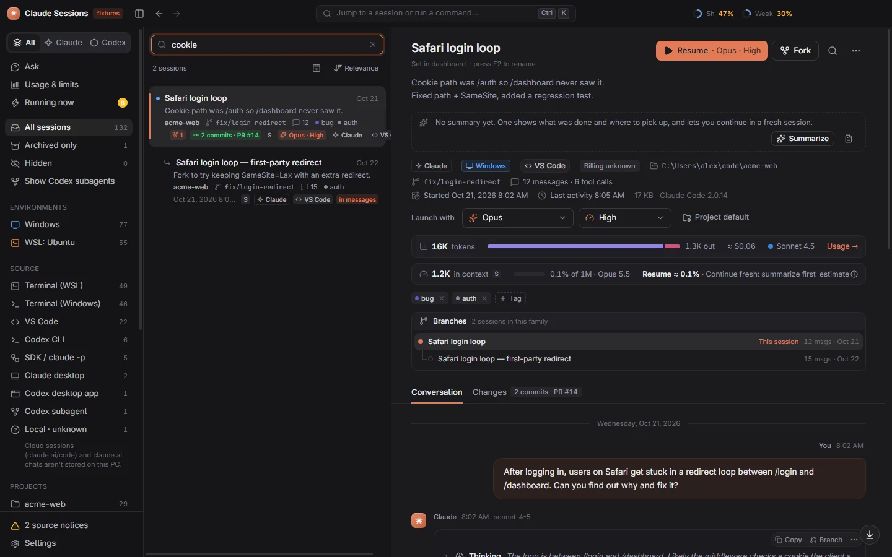

#### The viewer

- **Chat layout** with Markdown and highlighted code. Tool calls ("▸ Edit src/app.ts",
  "▸ Bash: npm test") and thinking blocks are collapsed until you click them; huge results are
  shortened with **Show all**. Codex's messages between agents show as collapsed
  **Agent → Agent** steps.
- **Copy** buttons on every message, code block and tool call (the full input and output), and
  **Copy whole conversation** as Markdown. Text can be selected normally too.
- **Find in session** (<kbd>Ctrl</kbd>+<kbd>F</kbd>) and **Export to Markdown**
  (<kbd>Ctrl</kbd>+<kbd>E</kbd>).
- The header shows the session's usage, its context size and its **Branches** family; the
  **Changes** tab shows what it committed ([git links](#git-links)).

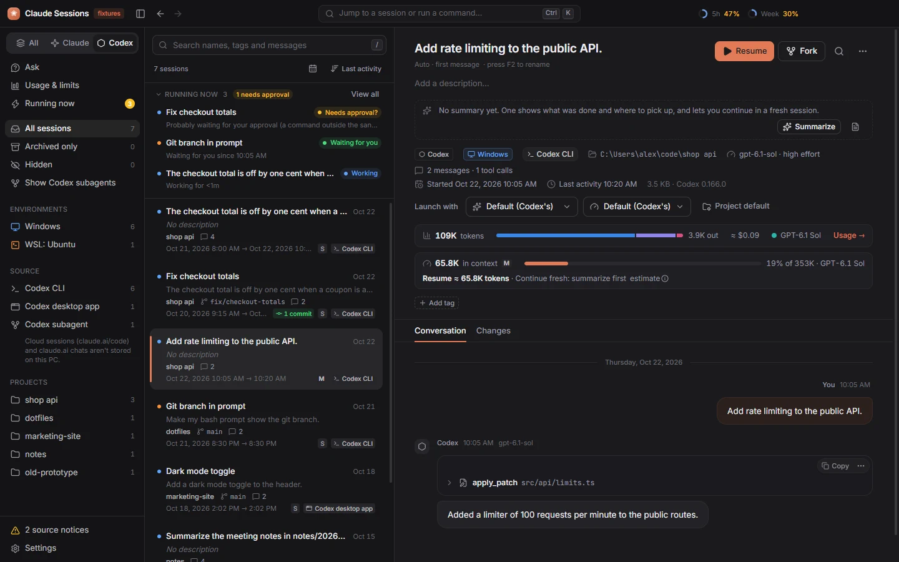

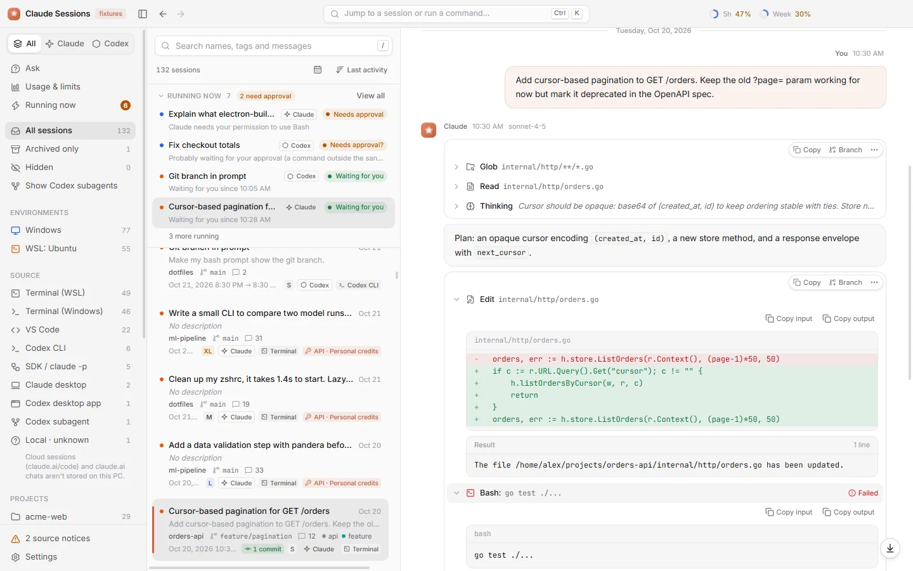

#### Pick several sessions

<kbd>Ctrl</kbd>+click and <kbd>Shift</kbd>+click, or from the keyboard: <kbd>Space</kbd> picks the
focused session, <kbd>Shift</kbd>+<kbd>↑</kbd>/<kbd>↓</kbd> extends the range, <kbd>Ctrl</kbd>+<kbd>A</kbd>
picks the whole list and <kbd>Esc</kbd> clears. A bar then offers bulk actions such as
**Summarize selected** and **Use Claude Code names**.

#### Back and forward

The arrows next to the sidebar button, <kbd>Alt</kbd>+<kbd>←</kbd> / <kbd>Alt</kbd>+<kbd>→</kbd>,
<kbd>Backspace</kbd> (when you're not typing) and the mouse's side buttons go back through the
screens you visited: views and filters, the session, its Conversation / Changes tab, the Usage
tab, the provider switch and a Settings section, each with its scroll position. On the phone, the
back gesture does the same.

#### The archive

Claude Code deletes sessions older than its `cleanupPeriodDays` setting (30 days by default). The
app copies every Claude Code session file into its own archive as soon as it sees it, so nothing
is lost. A session whose original is gone gets an **Archived only** badge and can still be read,
searched and resumed (the archived copy is put back first; an existing file is never
overwritten).

- Settings → **Archive** shows the archive's size and folder (**Open folder**).
- Codex sessions are archived only if you choose to (Settings → **Archive**: Off, named / pinned /
  tagged, or all), since Codex doesn't delete old sessions itself.
- Settings → **Claude Code cleanup** shows each home's current `cleanupPeriodDays` (read only), with
  how to raise it.

### Resume, fork, branch and continue

#### Resume and fork

**Resume** (<kbd>Ctrl</kbd>+<kbd>Enter</kbd>) opens the session in a new terminal in its own
folder, for Windows and WSL sessions alike. **Fork** (<kbd>Ctrl</kbd>+<kbd>Shift</kbd>+<kbd>Enter</kbd>)
starts a copy and leaves the original untouched. The dialog shows the exact command, the working
folder (with **Choose…** if it no longer exists), the terminal, billing, model and effort.

- **Terminal:** Windows Terminal, PowerShell or cmd (Settings → **Resume**). WSL sessions run
  `wsl.exe -d <distro> --cd <folder> -- bash -lic "claude --resume …"`, so a `claude` installed with
  nvm is found.
- **Codex sessions** resume with `codex resume` / `codex fork`, with Codex's own model and
  reasoning effort.
- **Copy resume command** (<kbd>Ctrl</kbd>+<kbd>Shift</kbd>+<kbd>C</kbd>) copies a command you can
  paste into PowerShell yourself.
- **New session in this folder…** (⋯ menu or command palette) starts a fresh session in the same
  place.
- **Open terminal here** (⋯ menu, or hover a project in the sidebar) opens a plain terminal in the
  session's folder, without Claude.

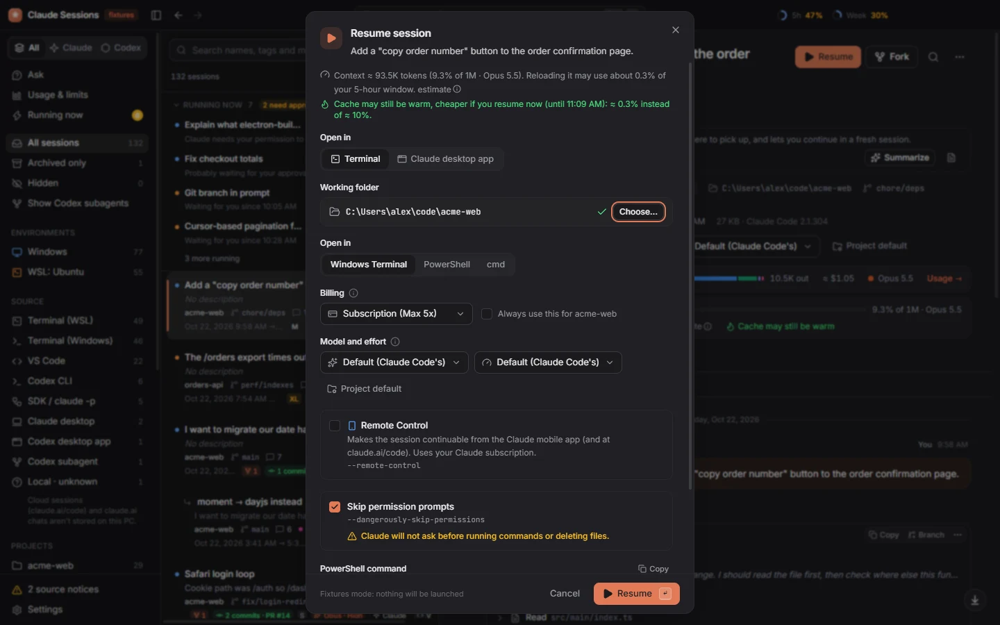

#### Model and effort

Pick them under the session's title (**Launch with**) or in the launch dialog: Default, an alias
(Fable, Opus, Sonnet, Haiku), a model seen in your logs, or any model ID; effort Low to Max. The
choice is saved for that session. **Project default** sets one for a whole project, and
Settings → **Resume** sets the global default (Codex has its own). **Default** adds no flag, so
Claude Code decides. The Resume button shows the result ("Resume · Opus · High").

#### Fast mode

**Fast** sits next to Model and Effort (Default, On or Off; off unless you turn it on), on the
desktop and the phone, and is remembered the same way: session, then project, then Settings. It's
offered only for models that have it: Claude's Fable 5.2, Opus 5.5 and Opus 5, and the Codex models
whose entry in Codex's own model list (`models_cache.json`, read only) offers the Fast tier.

- **Claude Code** gets `--settings <the app's launch\fast-mode.json>`, a file in the app's data
  folder holding only `{"fastMode": true}`, so none of your other Claude Code settings change. On
  the subscription, fast mode is billed to usage credits (not your plan limits) and only works if
  usage credits are turned on in your Claude account.
- **Codex** gets `-c service_tier=fast`. It uses your plan's limits at 2.5×, so the launch dialog
  warns when Codex's 5-hour window is above the pause line in Settings → Summaries.

**Off** adds no flag (your own `/fast` setting or `service_tier` applies). The flag is in **Copy
resume command**, the Resume button and badges say "Fast", and it isn't passed when a session opens
in the Claude desktop app or the Codex app (turn it on there).

#### Skip permission prompts

`--dangerously-skip-permissions` (Codex: `--dangerously-bypass-approvals-and-sandbox`) is **on by
default**, with a per-launch checkbox, a warning label and a default in Settings → **Resume**.
Launches from a phone never use it.

#### Remote Control

Tick **Remote Control** in the dialog (or make it the default in Settings → **Resume**) to start
Claude Code with `--remote-control`, so you can carry on in the Claude mobile app or at
claude.ai/code. These sessions get a **📱 Remote** badge that links straight to them. It uses your
Claude subscription.

#### Open in Claude desktop app

For Windows sessions, **Open in → Claude desktop app** in the Resume dialog hands the session to the
desktop app's Code tab (`claude --desktop --resume`, Claude Code 2.1.285 or newer). Resume only:
Fork isn't offered there.

#### Open in Codex app

Codex sessions can open in the Codex desktop app instead of a terminal (**Open in → Codex app**):

- **Resume** opens the thread in its project. **Fork** opens it too, and points you to Fork in the
  app's own menu (the app has no fork link).
- **Continue fresh** opens a new thread in the session's Codex project with the handoff line typed
  in, ready for you to press Enter.
- The choice appears only where the app can really open that launch. A folder that is only _inside_
  a Codex project asks "Use that project anyway?" first; a folder that isn't a project says so.
- The choice is remembered per session, per project, or for every Codex session (Settings →
  **Resume**). From the phone, **Open in Codex app on PC** opens the thread on your PC.

#### Branch from any message

Hover a message and click **Branch** (or right-click it) to continue the conversation from that
point in a new session; on your own messages, **Branch from before this message** lets you ask
something different. The first time, the app explains that it adds **one new session file** next
to the original and asks you to confirm; nothing existing is changed. The **Branches** panel shows
the whole family, and the transcript marks where branches split off.

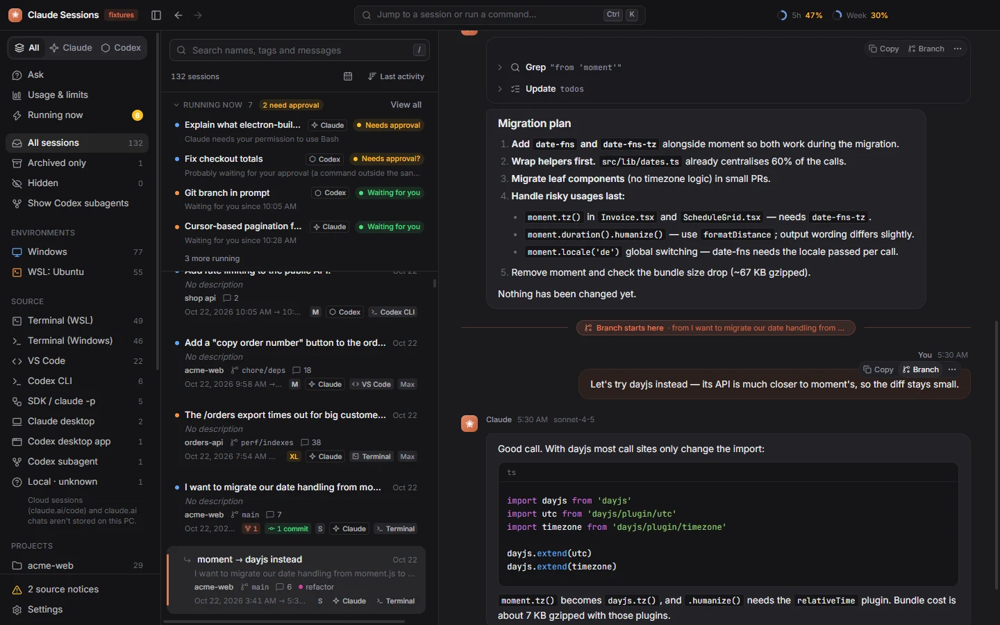

#### Context size warnings

Each session has a context size badge (S / M / L / XL, exact tokens on hover) and a **Context
size** sort. The viewer shows the tokens, the share of the model's context window, compactions,
and what resuming would cost next to what [Continue fresh](#summaries-and-continue-fresh) would.

Before resuming a **large session** (150K tokens by default, Settings → **Context size**), the
dialog warns: "Large session: about 192K tokens. Resuming may use about 21% of your 5-hour
window", with **Continue fresh** (or **Summarize first**), **Fork**, **Resume anyway** and **Don't
warn for this session**. The % is an estimate from your [limit-health baseline](#your-baseline-and-plans);
a still-warm prompt cache is priced cheaper. Codex sessions get the same warning. How it's worked
out: [docs/DETAILS.md → Context size](docs/DETAILS.md#context-size).

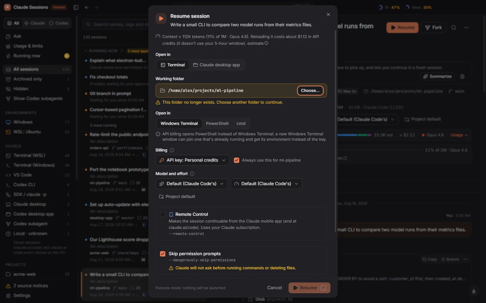

#### No duplicate terminals

Two copies of one session would write into the same file, so before Resume, Fork or Continue fresh
the app checks [Running now](#running-now-and-alerts). If the session is already open, the dialog
offers **Focus terminal** first, and **Start another copy…** behind a confirm. On the phone it
offers **Open in Claude app** (with Remote Control on), or tells you to type `/rc` in that terminal.

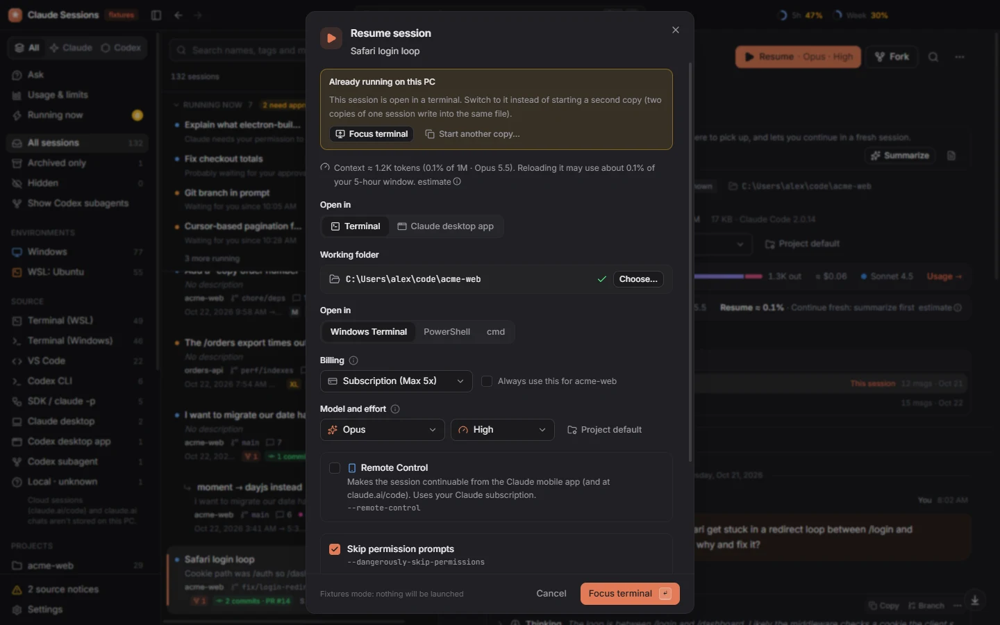

#### Billing per launch

Run any session on your subscription or on an API key: change **Billing** in the dialog, and tick
**Always use this for <project>** to make it the project's default. The key goes only into that
one terminal's environment, never on a command line or in a file. Add keys in Settings →
**Accounts & API credits** ([API credits](#api-credits)).

### Summaries and Continue fresh

**What it does.** A summary shows a session at a glance: what was done, files changed, decisions,
open to-dos and where to pick up. **Continue fresh** starts a new session in the same folder from
that summary instead of reloading the whole history, which is much lighter on your 5-hour window.

**How to use it.**

- Click **Summarize** at the top of a session (or right-click it in the list). To do many at once,
  pick them and click **Summarize selected**: you see the tokens and the approximate share of your
  5-hour window first, and a panel in the corner shows the queue with **Cancel**.
- **Continue fresh** (on the summary, or ⋯ → **Continue fresh from summary…**) opens the launch
  dialog with the handoff it will start from. The new session shows as "continued from" in the
  Branches panel. Codex sessions get summaries and Continue fresh too.
- Edit, regenerate, copy or remove a summary. It's searchable and part of backups.

**What is sent, and when.** Summaries are written by Claude through **your own Claude Code**
(`claude -p`, no tools, on your subscription), only when you ask, or, if you turn it on,
automatically for big idle sessions (off by default). The first time, a notice explains what is
sent: the conversation's text and one line per tool call, never tool output, thinking or images,
with common secrets masked, cut to 120,000 characters. **Show exactly what is sent** shows the full
text for a summary, but it's optional: a summary you don't preview, and every auto-summary, is sent
without a per-session preview. The queue pauses when your live 5-hour limit is above 80%. Runs show in Usage as
"Summaries (dashboard)". Summaries live only in the app's data, never in Claude's files.

**Where.** The session header; Settings → **Summaries** (model, size limit, pause line,
auto-summarize, handoff files). Details: [docs/DETAILS.md → Summaries](docs/DETAILS.md#summaries-and-continue-fresh).

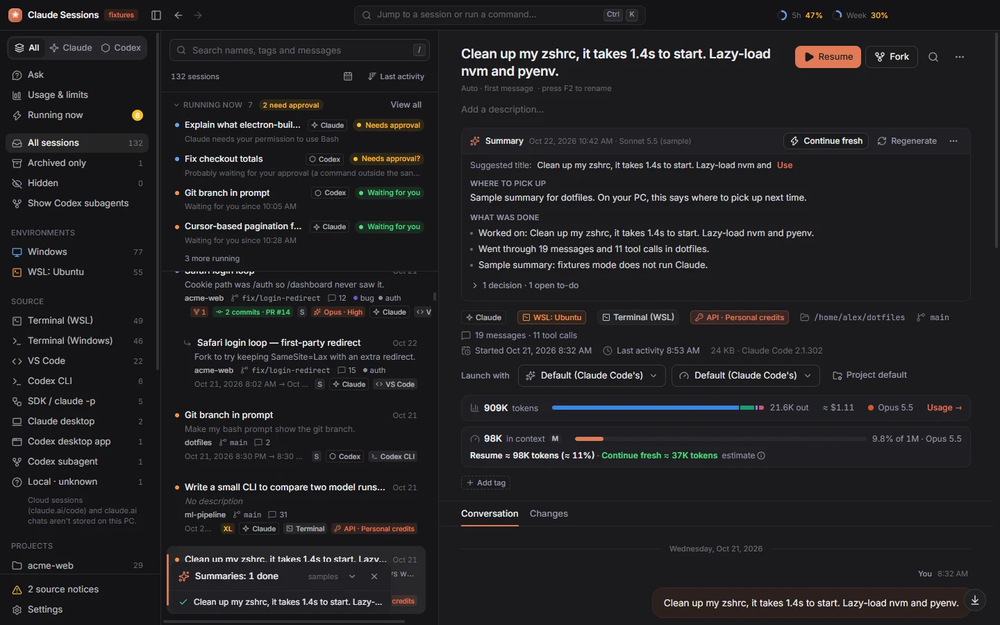

### Ask across all sessions

**What it does.** Ask questions about your whole Claude Code, Codex and Claude desktop history.
Open it from the sidebar (**Ask**), with <kbd>Ctrl</kbd>+<kbd>Shift</kbd>+<kbd>K</kbd> or from the
command palette.

#### Local questions

"How many sessions used Opus last week?", "Which sessions touched bridge.ts?", "What did I spend on
Codex last month?", "How often did I hit my limit this month?": questions about counts, dates,
models, usage, spend, limits, plans, commits, PRs and files are worked out **on your PC** from the
app's own data, with **How this was answered**. Nothing is sent, and they work even while content
questions are off.

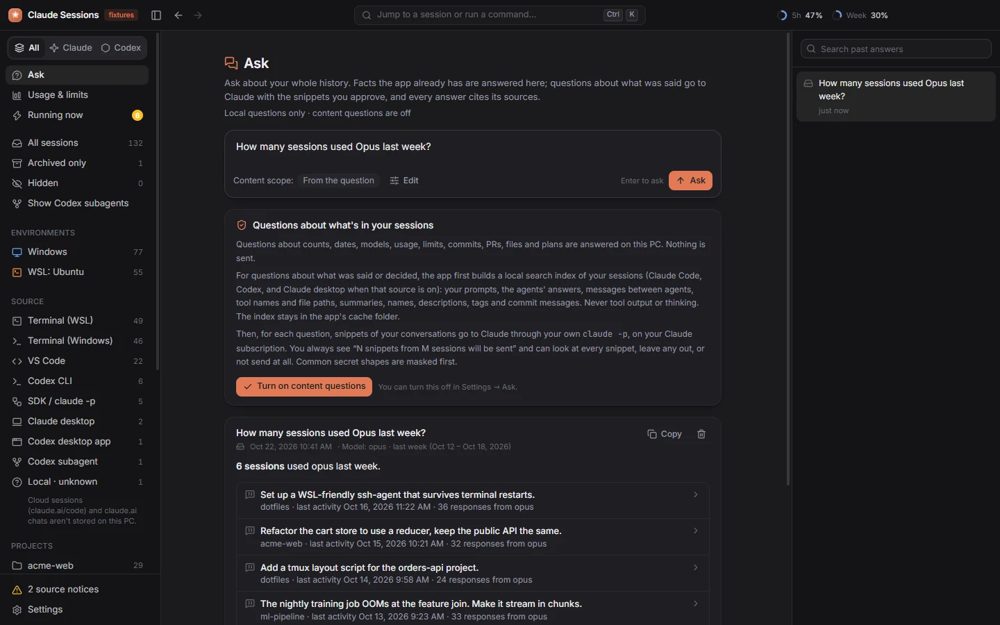

#### Content questions

"Where did I fix the WSL path bug?", "What did I decide about pricing?": questions about what was
said or decided. They're **off until you turn them on** (on the Ask screen, or Settings → **Ask**,
after a one-time notice). Then the app builds a local search index of your sessions (your prompts,
the agents' answers, tool names and file paths, plans, summaries, names, tags and commit messages;
never tool output or thinking) in a background worker.

#### The preview

Every content question shows **"N snippets from M sessions will be sent"** first. Open it to read
every snippet, untick any snippet or session, or see the exact text. Common secret shapes are
masked. Nothing is sent until you click **Send**; it then goes to your own `claude -p` with no tools
and none of your settings, on your Claude subscription. The preview warns when your 5-hour limit is
above the pause line, and usage shows as "Ask (dashboard)".

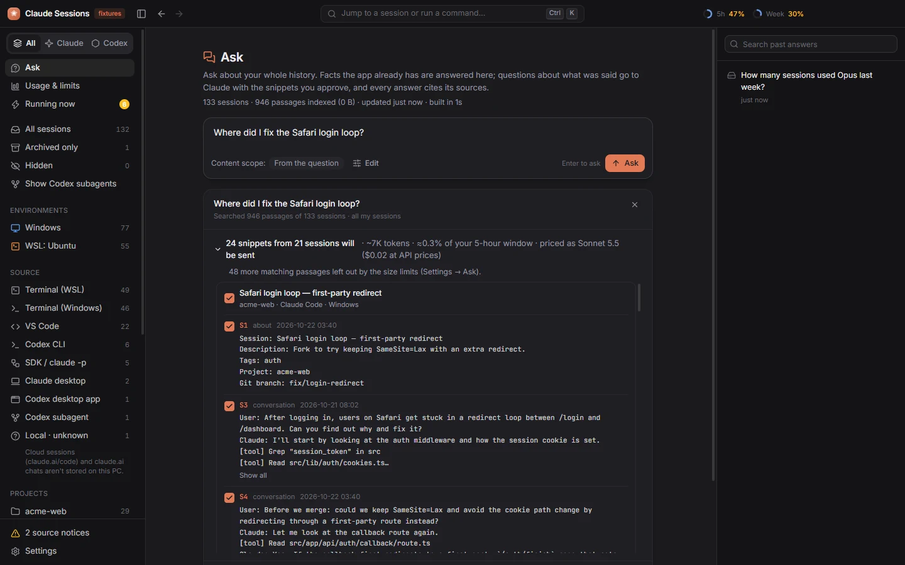

#### Citations

Every statement in the answer must cite a snippet you sent; a statement without a valid source is
removed (and listed). Each citation opens the session at that message, or its Changes tab at that
commit. If the snippets don't hold the answer, it says **Not found in your sessions**. Answers are
kept in a searchable history you can delete from item by item, and **Copy** includes numbered
sources.

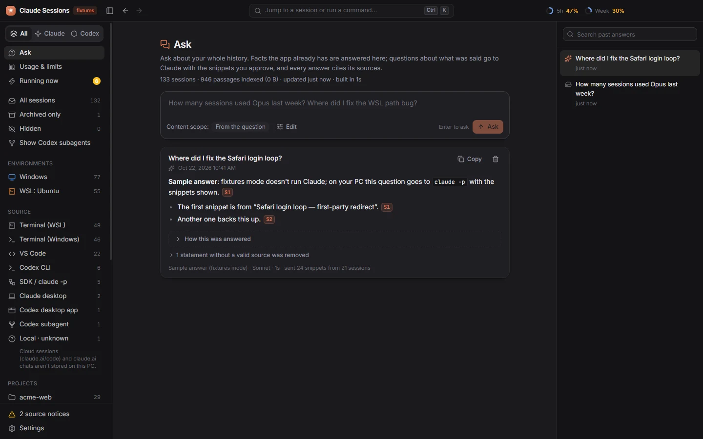

#### Model and effort for answers

Model and effort pickers sit next to **Send** (defaults in Settings → **Ask**, and your last choice
is remembered). Scope filters narrow a question to agents, sources, environments, dates, projects,
subagents or hidden sessions. Settings → **Ask** also has the snippet limits, the index size limit,
and **Rebuild** / **Delete index**.

On the phone, the **Ask** tab shows your past answers and answers local questions at once; a
content question waits on the PC, and nothing goes to Claude until you review the preview there and
click **Send** (it expires after 15 minutes). Answers are written by Claude only: `codex exec` can't
be run without tools, so it isn't offered. Details:
[docs/DETAILS.md → Ask across sessions](docs/DETAILS.md#ask-across-sessions).

### Running now and alerts

**What it does.** **Running now** (sidebar, with a count, and a section at the top of the list)
shows every Claude Code and Codex session that's running on Windows and in WSL, and alerts you when
one needs you.

<picture>
  <source media="(prefers-color-scheme: dark)" srcset="docs/images/running-now-dark.webp">
  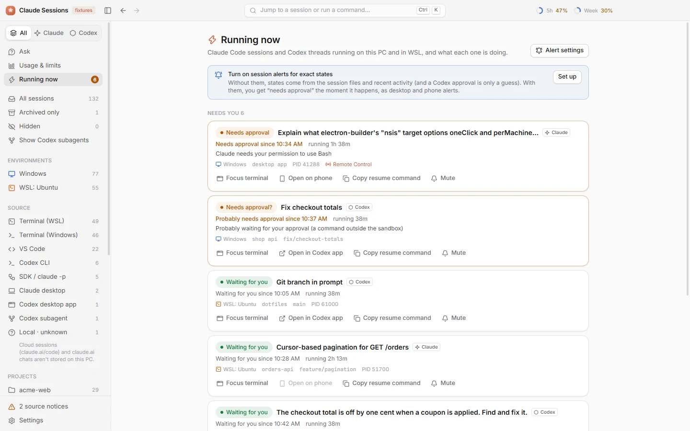
</picture>

#### Session states

- **Working**, **Needs approval**, **Waiting for you** (finished, ready for your next message) or
  **Exited**, with how long it has been running and "waiting for you since …".
- **Focus terminal** brings the session's terminal window forward and selects its tab (give a
  session a name with `/rename` to make it easy to find). **Open on phone** shows a QR code of its
  Remote Control link. **Copy resume command** and **Mute** are there too. Codex threads offer
  **Open in Codex app** instead of Remote Control.
- It works with **no setup**, from Claude Code's own session files and Codex's thread locks (read
  only, never in Codex's way). Without hooks, a Codex approval is a best guess ("**Needs
  approval?**").

#### Session alerts (hooks)

For exact, instant states, Settings → **Session alerts** → **Enable session alerts** for each
environment (Windows, and each WSL user). The app shows the exact change to Claude Code's
`settings.json` first, backs the file up, and adds its hooks **at the end** of each event's list;
your own hooks stay exactly as they are. **Disable** takes out exactly the app's hooks.

For Codex, **Enable approval alerts** adds one hook to that Codex home's `~/.codex/hooks.json` the
same way. Codex then asks you to trust it in its `/hooks` screen (the app never does that for you).

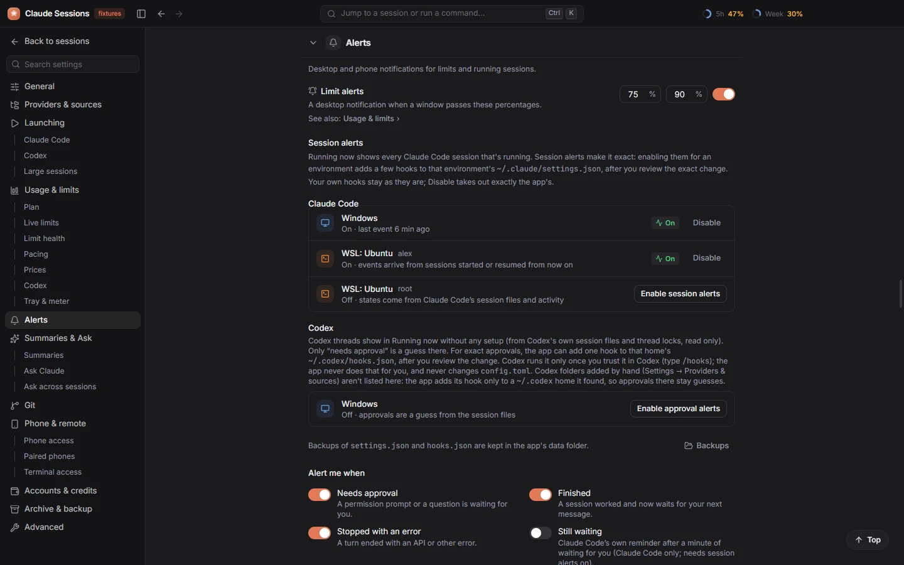

#### Desktop notifications

Windows notifications when a session needs approval, finishes (after a minimum working time), stops
with an error, keeps waiting, or ends. Pick the events, set **quiet hours** (approvals can still
come through), and mute single sessions, in Settings → **Session alerts**. Clicking a notification
opens the session.

#### Phone push alerts

On each phone that should get alerts: **Running** tab → **Turn on push alerts** (on an iPhone, add
the app to the Home Screen first). Pushes arrive even when the phone app is closed. A push says
only what happened ("A session needs your approval"), never names, folders or text; tapping it
loads the details from your PC over Tailscale. Settings → **Phone** shows which phones have push on.
Details: [docs/DETAILS.md → Running now](docs/DETAILS.md#running-now-and-session-alerts).

### Usage and limits

Open it from the sidebar (**Usage & limits**), with <kbd>Ctrl</kbd>+<kbd>U</kbd>, or by clicking the
gauges in the title bar.

<picture>
  <source media="(prefers-color-scheme: dark)" srcset="docs/images/usage-dark.webp">
  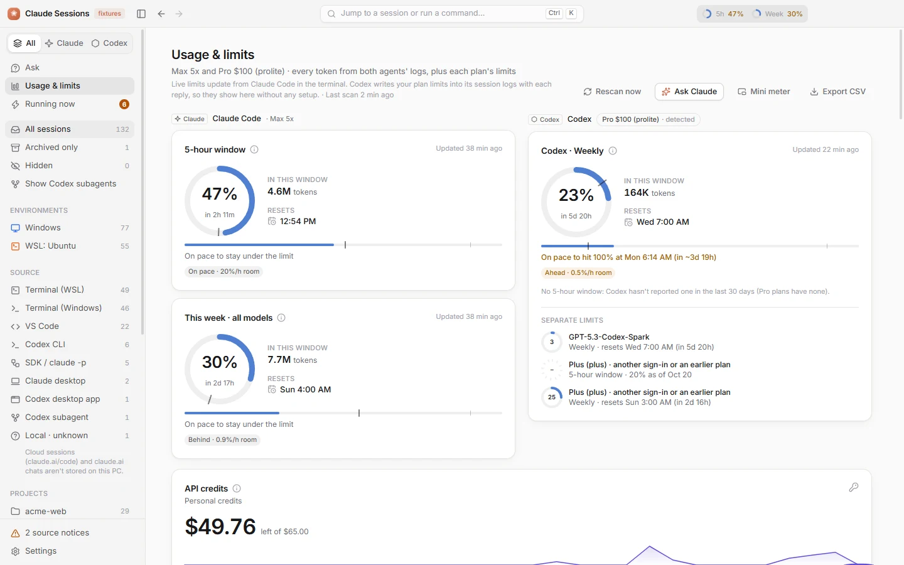
</picture>

#### Live limits

Your real **5-hour** and **weekly** plan percentages (the same ones `/usage` shows), with reset
countdowns, the tokens used in each window, a projection ("On pace to hit 100% at 4:30 PM") and
alerts at 75% and 90%.

**Turn it on:** Settings → **Live limits** → pick your plan → **Enable live limits** next to each
environment → check the diff → confirm → send any message in Claude Code. The app adds a tiny
**status line bridge** (only the `statusLine` key of `settings.json` changes, your current status
line keeps working, and **Disable** puts the old value back exactly). Live limits exist for Pro and
Max subscriptions. Readings are kept forever, and an old reading is labeled "No recent reading",
never shown as 0%.

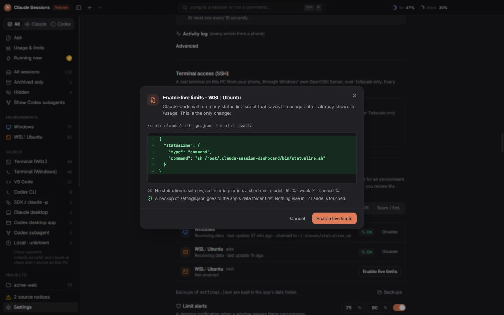

#### Pacing

A tick on each gauge marks where your usage should be by now to end the window at your cap (90%
by default), with **Behind / On pace / Ahead** and the room you have left per hour. Settings →
**Pacing**.

#### Token usage and costs

Every token, forever: read from your session logs and the archive, so history survives Claude
Code's cleanup. Today / week / month / all-time cards, a stacked chart by day, week or month with
a date range and model filter, a model share donut, the top sessions, and a raw table by model,
session, project, environment, version, billing or source, with **CSV export**. Costs are
estimates at API list prices from an editable price table (Settings → **Usage**), fast mode
included. Per-session usage shows at the top of each session.

**Token speed:** each card and each model in the Models card shows the median output speed
(tokens per second), and each session shows its own, with its time to first token and a **Fast**
badge when it used fast mode. It's an estimate from log timestamps (from when a request was sent
to when the reply's last part was written, tool time left out), so waiting, thinking, network and
server load all count. Fast mode is always counted apart from normal mode.

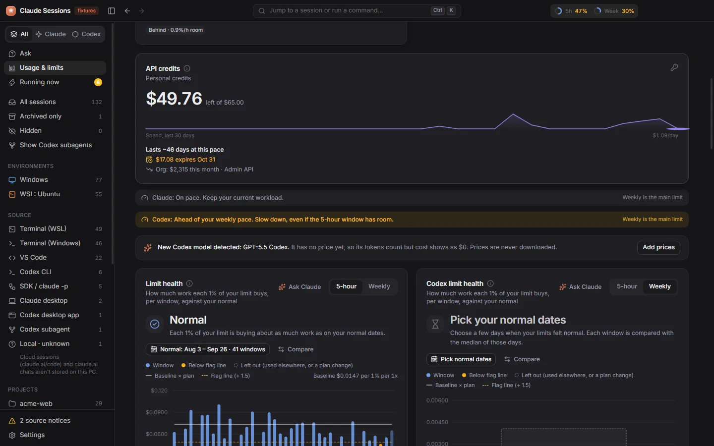

#### Codex usage and limits

Codex needs no setup: it writes its token counts and plan limits into its own logs. You get its
usage (input, cached input, output, reasoning; per model, session, project, environment and client),
its 5-hour and weekly gauges (and any separate limit, such as one model's own), its plan
(detected from the logs or chosen), pacing, limit health and price table. With the switch on
**All**, Claude and Codex each keep their own gauges (never one combined %), and charts stack or
split by provider. Settings → **Codex usage & limits**.

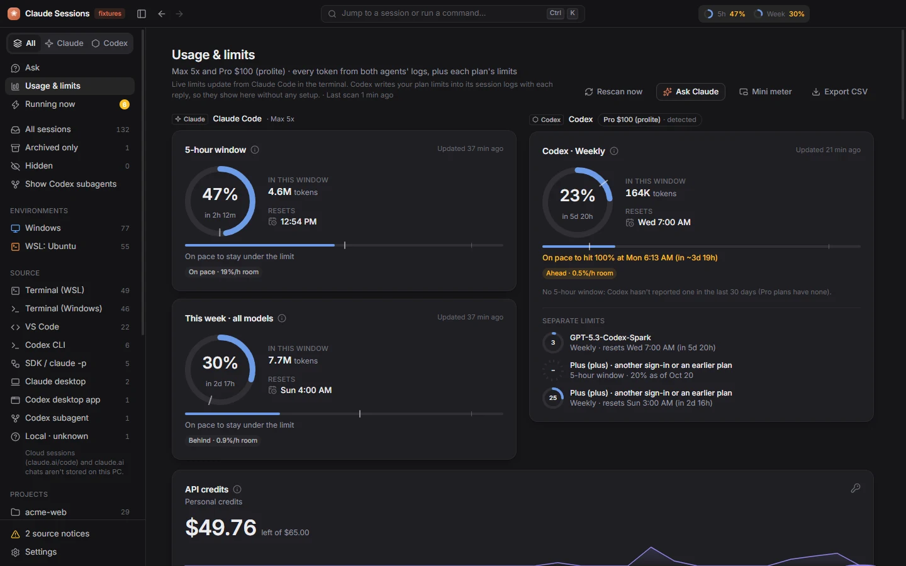

#### At a glance: title bar, tray and mini meter

Small gauges in the title bar, a tray icon with the 5-hour % (hover for both windows, click to open
Usage) and an always-on-top **mini meter** you can drag anywhere. Each can show Claude, Codex or
both (Settings → **Codex usage & limits**).

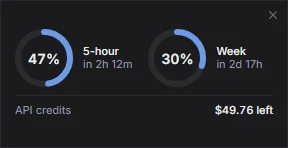

#### API credits

Settings → **Accounts & API credits** → **Add API key…**. Run sessions on API credits
([billing per launch](#billing-per-launch)), enter the credit grants you receive, and see the
balance, spending, burn rate and how long they will last. An **Admin key** also pulls your
organization's usage and cost reports. Keys are encrypted with Windows (DPAPI) and never shown,
logged or put on a command line.

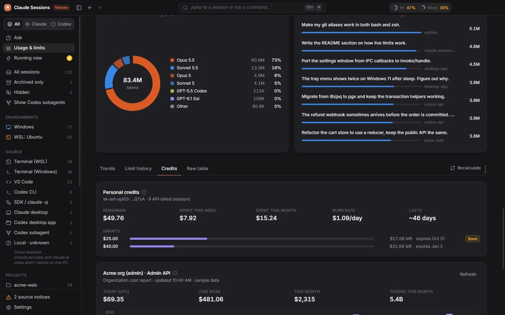

#### Ask Claude about your usage

**Ask Claude** (Usage view or the Limit health card) answers "Have my limits dropped?" or "Why did
I hit my limit Tuesday?" through your own Claude Code. Only aggregated numbers are sent (no
session titles, projects or text). The exact data is shown before you send, until you tick
**Don't show again**.

### Nerf detector: limit health and trends

**"Did my limits get smaller? Is the model worse this week?"** Anthropic doesn't publish limits as
token counts, so the app measures them from your own work: how much each 1% of your plan buys, how
the models behave week by week, and where your usage went. Claude and Codex each get their own.
Open it in **Usage & limits** (<kbd>Ctrl</kbd>+<kbd>U</kbd>): the **Limit health** card, then the
**Trends** and **Limit history** tabs.

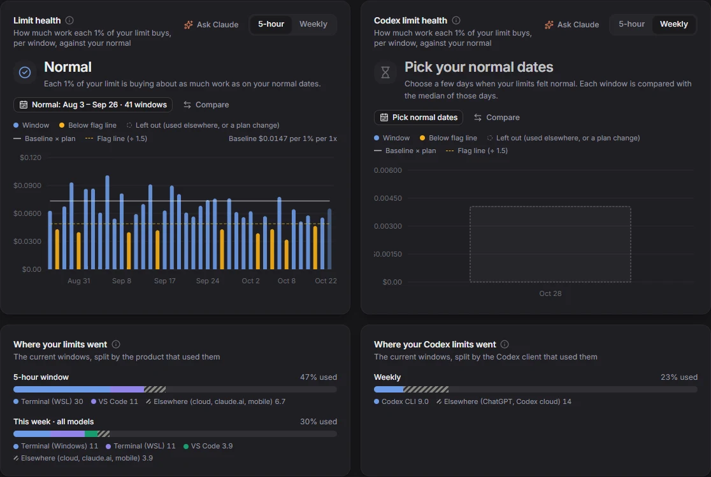

#### The score: dollars per 1%

Each finished 5-hour and weekly window gets one score, **API-equivalent dollars per 1%**: the tokens
you used in that window (subagents included, each response counted once), priced at API rates for
input, output, cache reads and cache writes, divided by the % the window reached. A higher score
means 1% bought more work. Hover a bar to see its **token mix**, since a big shift in mix can move
the score on its own.

#### Your baseline and plans

- **Pick your normal dates** on the card: a stretch when your limits felt normal. The median score
  of those windows is your **baseline**.
- **Plan history** (Settings → **Limit health**): Pro, Max 5x, Max 20x or a custom multiplier, each
  with a start date. Every window is compared with the baseline for the plan it ran on, so an upgrade
  never reads as a cut, and plan changes are marked on the chart. Codex has its own plan (detected
  from its logs, e.g. "Pro $100"), multipliers and baseline.

#### The verdict

**Normal**, or **Possible reduction** only when the last **2** finished windows in a row fell below
the baseline ÷ **1.5** (both numbers are settings). Windows under 10% are skipped as too coarse, and
until there are enough windows it says how many more it needs. Ask **"Have my limits dropped?"** in
[Ask Claude](#ask-claude-about-your-usage) for a written read of the same numbers.

#### Where your limits went

The current 5-hour and weekly windows split by what used them (terminal on Windows or WSL, VS
Code, Claude desktop, the SDK, and for Codex each client), plus an **Elsewhere** slice for usage
your logs don't explain: claude.ai, the mobile apps, cloud sessions, another PC.

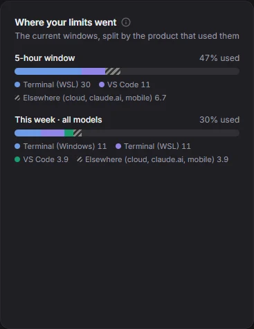

#### Limit history

The **Limit history** tab lists every **"usage limit reached"** message found in your sessions
(with when it reset and how many tokens that window held), your **recent 5-hour blocks** (grouped
like ccusage's blocks, with tokens and cost), and the times you marked as **Used Claude elsewhere**
(**Mark a time**), so a window you spent on claude.ai doesn't read as a cut.

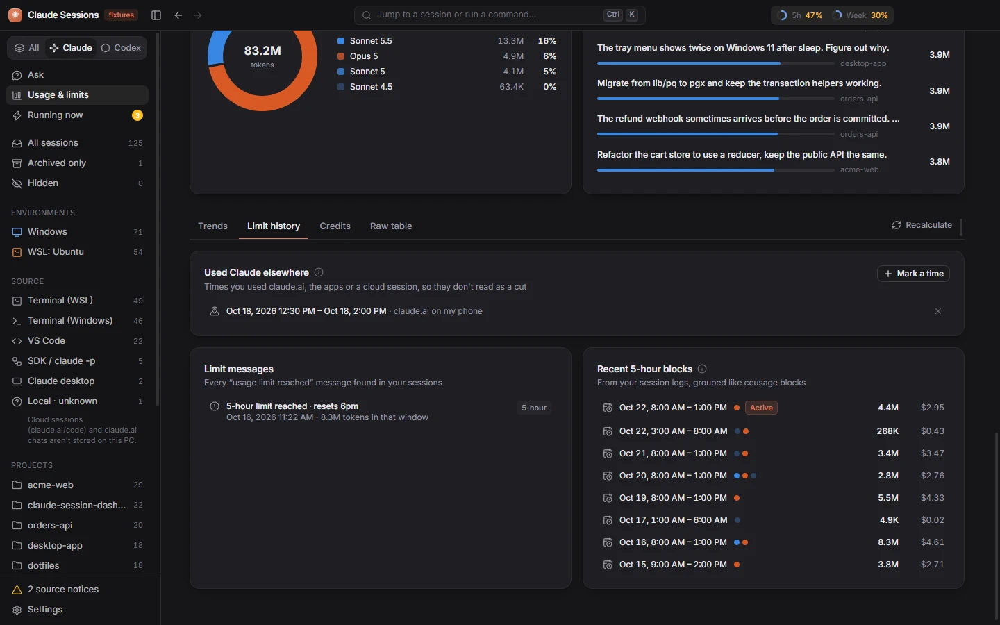

#### Trends

Weekly charts, **all together, by model or by Claude Code version**, with markers for new models,
Claude Code updates, plan changes and score changes:

- **Output:** output per response and per message you sent.
- **Speed:** median response time (gaps over 10 minutes ignored), output speed in tokens per
  second (also without thinking tokens), and time to first token (an estimate, from replies that
  start with thinking; the ⓘ says how many). Fast mode gets its own dashed line.
- **Reliability:** tool error rate, and API errors and retries.
- **Effort:** assistant turns and tool calls per message you sent.
- **Your corrections:** interruptions, and messages that start with "no", "wrong" or "that's not".
- **Caching and thinking:** cache read ratio, thinking blocks per response and their length.
- **Context:** how much of the context window sessions use.

Codex gets its own set: output and reasoning per response, turn time, time to first token (Codex's
own), output speed (also without reasoning), tool error rate, interrupted or failed turns,
responses and tool calls per prompt, cached input ratio and context use. With the switch on
**All**, one more chart puts every Claude Code and Codex model's output speed side by side.

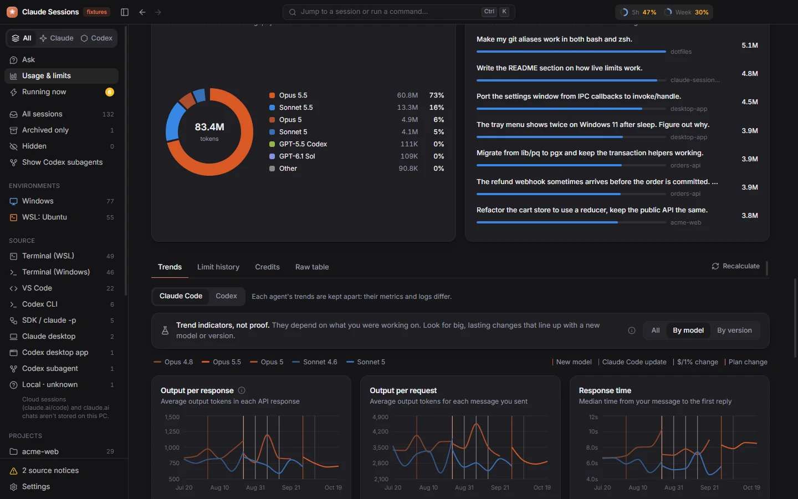

#### Compare

Put **two date ranges, or two Claude Code (or Codex) versions,** side by side: every trend metric
with the % change, marked **better** or **worse**. The Limit health card has its own **Compare**
for the score itself (as measured, per plan, and the token mix).

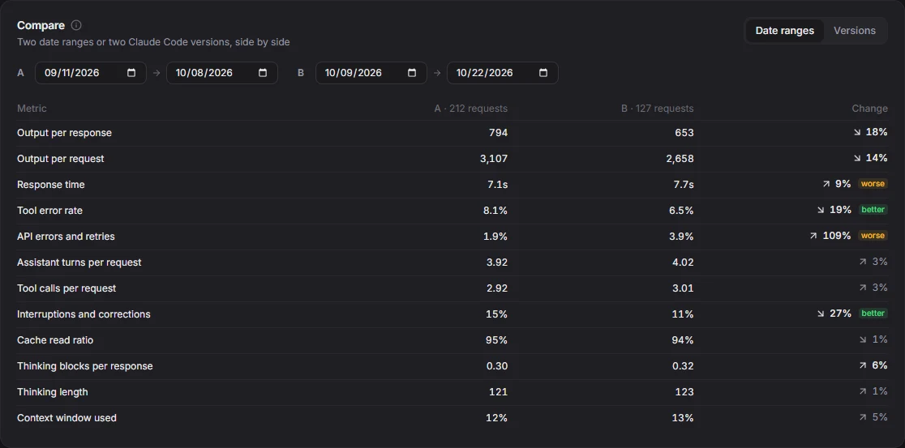

#### Keeping it honest

- **One price per model family** (on by default): every Opus model is priced like the newest Opus,
  and so on, so moving to a cheaper model doesn't look like a smaller limit.
- **Usage elsewhere:** when the % rose while nothing ran on this PC, that window is clearly
  affected; above 25% (a setting) it's left out of the baseline and the verdict, and drawn dashed.
  Smaller unexplained parts are shown as a warning, since a real cut looks the same.
- **Older readings count too:** if you ran `/usage` in Claude Code before turning on live limits,
  the percentages it printed are read from your transcripts.
- **Speed is a side signal:** the Limit health card shows each busy model's output speed in the
  last 7 days against the 4 weeks before, clearly apart from the score; it never changes it.
- **Indicators, not proof:** trends depend on what you were working on. Look for big, lasting
  changes that line up with a new model or version.

Method in full: [docs/DETAILS.md → Limit health](docs/DETAILS.md#limit-health-did-my-limits-get-smaller)
and [What the numbers mean](docs/DETAILS.md#what-the-numbers-mean-and-their-limits).

### Git links

**What it does.** Each Claude Code and Codex session is linked to the commits, branches and pull
requests it produced, read from your local git (read only).

**How to use it.**

- Open a session and click **Changes** (next to Conversation): its commits with message, time,
  branch and +/−, each with a confidence (**Exact**, **High**, **Medium**; time-only matches are
  listed apart as **Possible**) and the reasons on hover. Expand a commit for its files, and a file
  for its diff.
- **Sessions that touched this file** on any file, and `touched:<file>` / `commit:<sha>` in the
  search box.
- Badges on cards ("3 commits · PR #14"). **⋯ → Unlink from this session** takes a wrong match off.
- **Pull requests** come from the session's own `gh pr create` output and merge commits, and, if
  you say yes once, from your **GitHub CLI** (`gh pr list`, read only, with your own sign-in).

**Where.** The Changes tab; Settings → **Git** (on/off, GitHub CLI). On the phone: a read-only list
of commits, files and PR links. Git is never written to: no commit, fetch or checkout, ever.
Matching rules: [docs/DETAILS.md → Git links](docs/DETAILS.md#git-links).

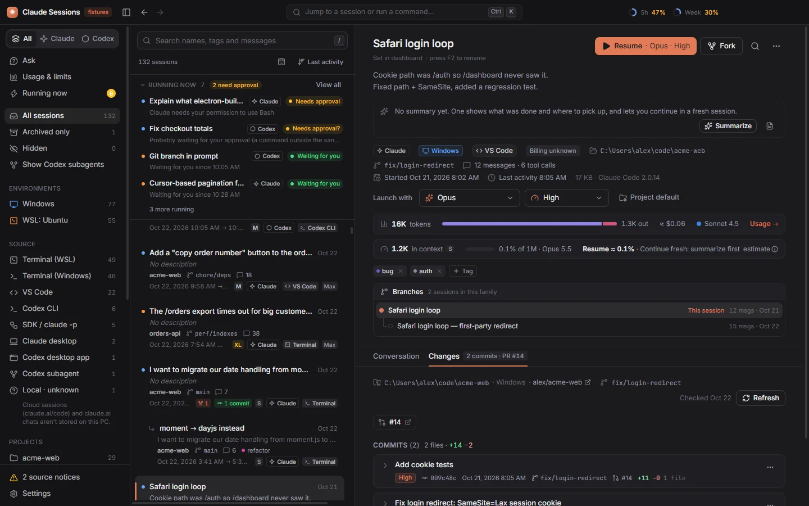

### Phone companion

**What it does.** The dashboard on your phone, in a phone layout that updates live and installs to
your home screen: search and read sessions, rename, describe, tag, pin and hide them, read and edit
summaries, check usage and limits, see Running now, read your Ask history, and **Resume, Fork,
Branch or Continue fresh a session on your PC** with Remote Control on, then continue it in the
Claude app.

<table>
  <tr>
    <td>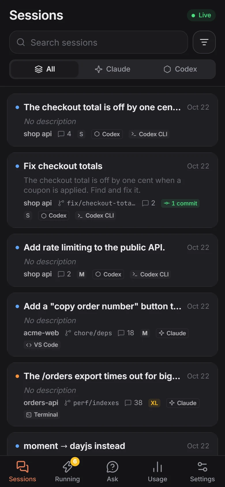</td>
    <td>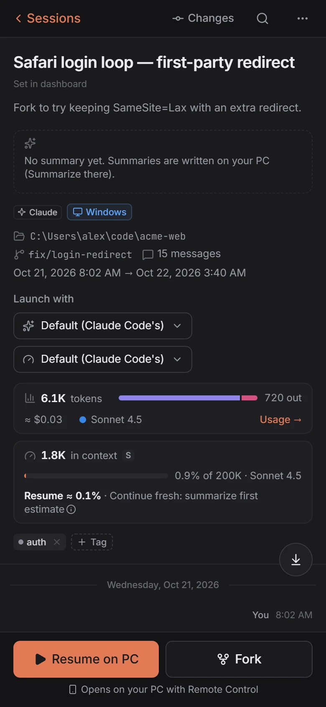</td>
    <td>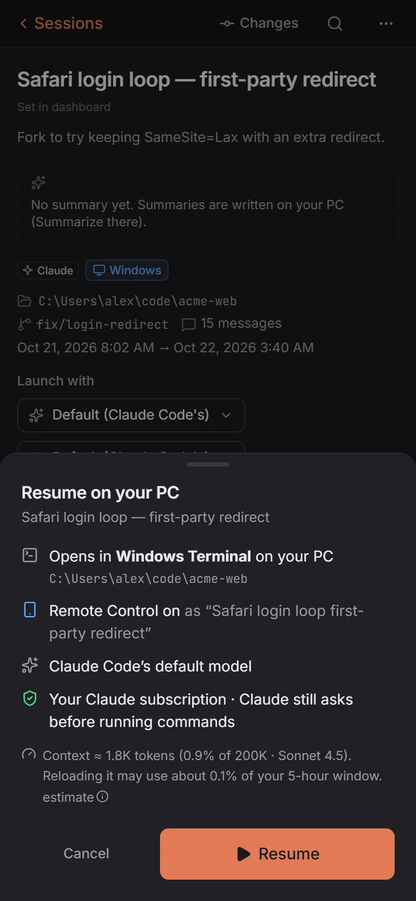</td>
    <td>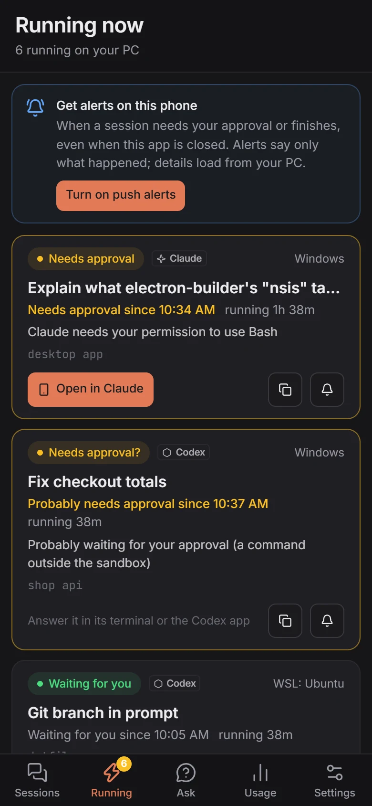</td>
    <td>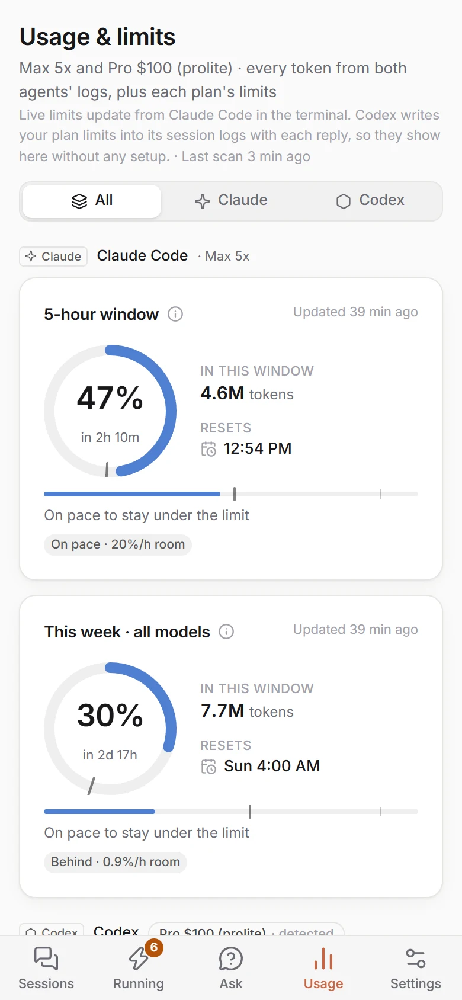</td>
  </tr>
</table>

**Set it up:** Settings → **Phone** → **Connect your phone…** walks you through it, checking each
step:

1. Install **Tailscale** on the PC (**Install for me** runs winget after you confirm) and sign in.
2. Install Tailscale on your phone, sign in with the same account and leave the VPN on.
3. **Turn on phone access.** If your tailnet doesn't have HTTPS certificates yet, click **Turn on
   HTTPS**, then **Try again**.
4. **Show pairing code**, scan the QR code with your phone's camera and tap **Pair this phone**.
5. **Send test**, then add the app to your home screen (Share → Add to Home Screen on iPhone,
   Install app on Android).

No Tailscale? Choose **Home Wi-Fi** in the wizard: pick the PC's network address, approve the
firewall rule and pair (the phone must be on the same Wi-Fi).

**What a phone can't do:** run any other command, change security, pairing or the server, see API
keys, or write summaries (that sends session text to Claude, so it stays on the PC). Phone launches
always use your subscription and keep permission prompts on. You can turn on **read-only mode**,
**Confirm launches on this PC**, revoke any phone, and read the **activity log** of every phone
action. Details: [docs/DETAILS.md → Phone companion](docs/DETAILS.md#phone-companion).

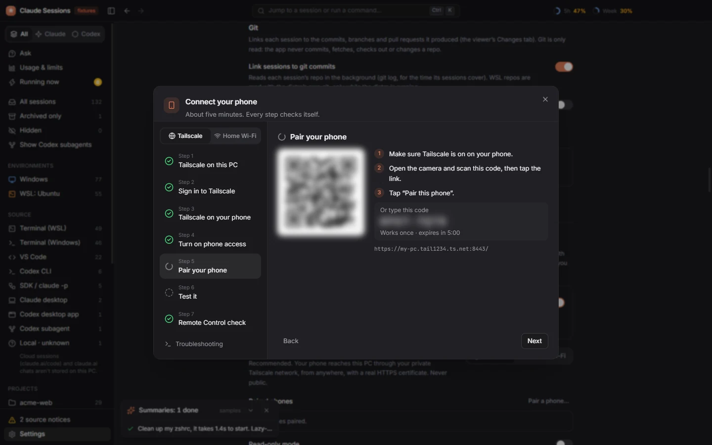

### Terminal access from your phone

**What it does.** A real terminal on your PC from your phone, through **Windows' own OpenSSH
Server**, reachable only over Tailscale. The dashboard never runs commands for the phone.

**Set it up:** Settings → **Terminal access (SSH)** → **Set up terminal access…**. Each step checks
itself, and each change shows its exact PowerShell script first; Windows then asks for
administrator rights.

1. **Tailscale** connected on the PC and the phone.
2. **OpenSSH Server:** **Install for me**.
3. **Firewall:** a rule that allows SSH only from Tailscale, Windows' "any address" rule turned off,
   then sshd started.
4. **Default shell:** PowerShell 7, Windows PowerShell or WSL.
5. **Keys:** paste your SSH app's public key, or send it from the phone (Settings → **Send SSH key to
   PC**) and **Allow** it on the PC after comparing fingerprints. Then **Turn off password login**.
6. **Phone app:** Termius, a-Shell (iPhone) or ConnectBot (Android).
7. **Test:** connect from the phone.

**Open terminal here** on a session or project then gives you an `ssh://` link and a copyable
`ssh` command that lands in that folder. Every change is logged and can be undone; **Turn off
terminal access** undoes them all. Details: [docs/DETAILS.md → Terminal access](docs/DETAILS.md#terminal-access-ssh).

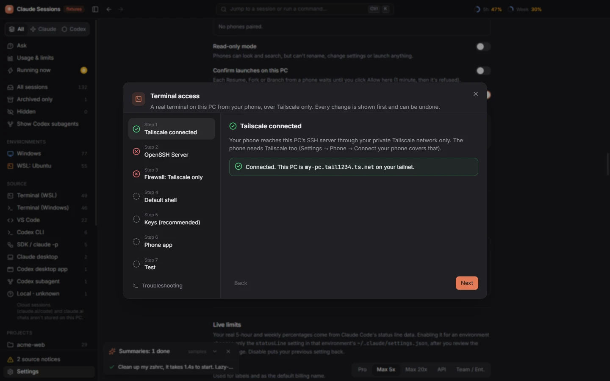

### Backup and restore

**What it does.** Backs up the app's own data (the session archive, your names, descriptions, tags
and summaries, usage and limit history, Ask histories and settings) to a folder you choose:
OneDrive, an external drive or a NAS. Your cloud app syncs it; the dashboard makes no network calls.

**How to use it.**

1. Settings → **Backup** → **Choose folder…**. The app writes only inside its own
   `ClaudeSessionDashboard Backup` folder there.
2. Optionally set a **password** (AES-256; recommended for a cloud folder, since backups hold your
   transcripts). Tick **Remember on this PC** so scheduled backups run unattended. **A lost password
   means unreadable backups.**
3. Pick **Daily** or **Weekly** and how many snapshots to keep (14 by default), or click **Back up
   now**.

- **Incremental:** only new or changed content is copied, compressed.
- **Catch-up:** a backup that came due while the app was closed runs two minutes after it starts,
  with a notification. Settings → **Startup** → **Start with Windows** (off by default) keeps the app
  running in the tray from sign-in.
- **Restore** (also on a new PC: choose the same folder): Settings → **Backup** → **Restore…**, pick a
  snapshot, see what would change, then **Restore and restart**. It writes only into the app's own
  data folder, never deletes a file, and keeps a copy of every file it replaces (cleanable after 30
  days).
- **Never in a backup:** API keys, phone pairing and push keys, the app's records of changes it
  made to Claude's, Codex's or OpenSSH's settings, caches, and **Continue fresh handoff files**
  (`handoffs\`). After a restore (or on a new PC), sessions started with Continue fresh keep their
  "continued from" link and the original's summary, but the handoff file their first message points
  to is gone, so resuming one of them can't re-read it. Details:
  [docs/DETAILS.md → Backups](docs/DETAILS.md#backups).

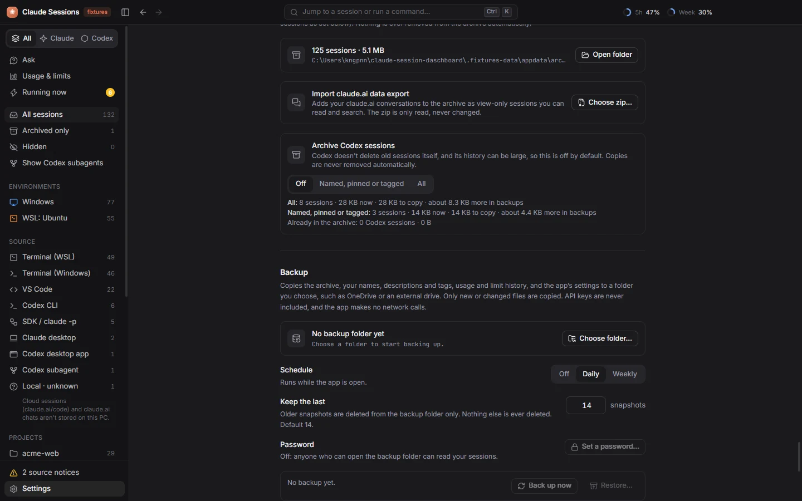

### Providers and settings

- **All / Claude / Codex switch** (top of the sidebar, also on the phone and in Usage) filters
  what you see. It never turns anything off.
- **Settings → Providers** turns Claude Code or Codex off completely (never both): it's then not
  scanned, archived or shown. Your names and archive copies stay, so turning it back on brings
  everything back.
- **Settings → Scan sources:** every detected home with its status, **Add folder…**, **Rescan now**,
  **Scan stopped WSL distros** (off by default, since reading a stopped distro starts it) and the
  optional **Claude desktop (Cowork) sessions** source.
- **Settings → Startup → Start with Windows (minimized to tray)**, off by default.
- **Settings → Appearance:** light, dark or system theme.
- Everything else lives next to the feature it belongs to: **Resume**, **Summaries**, **Ask**,
  **Context size**, **Session alerts**, **Git**, **Phone**, **Terminal access (SSH)**, **Live
  limits**, **Accounts & API credits**, **Usage**, **Limit health**, **Pacing**, **Ask Claude**,
  **Codex usage & limits**, **Archive**, **Backup**, **Claude Code cleanup** and **About** (your
  version). Press <kbd>Ctrl</kbd>+<kbd>,</kbd> to open Settings.

<picture>
  <source media="(prefers-color-scheme: dark)" srcset="docs/images/settings-dark.webp">
  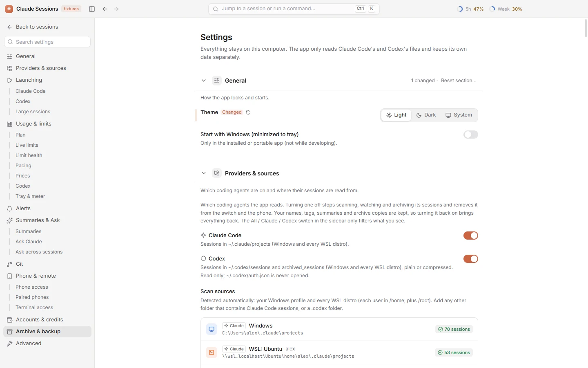
</picture>

---

## Keyboard shortcuts

Press <kbd>?</kbd> in the app for the full list.

| Keys                                                         | Action                                 |
| ------------------------------------------------------------ | -------------------------------------- |
| <kbd>Ctrl</kbd>+<kbd>K</kbd>                                 | Command palette                        |
| <kbd>/</kbd>                                                 | Search sessions                        |
| <kbd>Ctrl</kbd>+<kbd>Shift</kbd>+<kbd>K</kbd>                | Ask across sessions                    |
| <kbd>Ctrl</kbd>+<kbd>U</kbd>                                 | Usage and limits                       |
| <kbd>Ctrl</kbd>+<kbd>,</kbd>                                 | Settings                               |
| <kbd>Ctrl</kbd>+<kbd>B</kbd>                                 | Toggle sidebar                         |
| <kbd>Alt</kbd>+<kbd>←</kbd> / <kbd>Alt</kbd>+<kbd>→</kbd>    | Back / forward                         |
| <kbd>Backspace</kbd> (when not typing)                       | Back                                   |
| <kbd>F5</kbd>                                                | Rescan sources                         |
| <kbd>↑</kbd> <kbd>↓</kbd> or <kbd>J</kbd> <kbd>K</kbd>       | Next / previous session                |
| <kbd>Home</kbd> / <kbd>End</kbd>                             | First / last session                   |
| <kbd>Esc</kbd>                                               | Clear search, or clear the picks       |
| <kbd>Ctrl</kbd>+click, <kbd>Shift</kbd>+click                | Pick sessions, pick a range            |
| <kbd>Space</kbd>, <kbd>Shift</kbd>+<kbd>↑</kbd>/<kbd>↓</kbd> | Pick the focused session, extend range |
| <kbd>Ctrl</kbd>+<kbd>↑</kbd>/<kbd>↓</kbd>                    | Move the focus, keep the picks         |
| <kbd>Ctrl</kbd>+<kbd>A</kbd>                                 | Pick every session in the list         |
| <kbd>Ctrl</kbd>+<kbd>Enter</kbd>                             | Resume                                 |
| <kbd>Ctrl</kbd>+<kbd>Shift</kbd>+<kbd>Enter</kbd>            | Fork                                   |
| <kbd>Ctrl</kbd>+<kbd>F</kbd>                                 | Find in session                        |
| <kbd>F2</kbd> / <kbd>D</kbd> / <kbd>T</kbd>                  | Rename / edit description / add tag    |
| <kbd>H</kbd>                                                 | Hide / unhide                          |
| <kbd>Ctrl</kbd>+<kbd>E</kbd>                                 | Export to Markdown                     |
| <kbd>Ctrl</kbd>+<kbd>Shift</kbd>+<kbd>C</kbd>                | Copy resume command                    |
| <kbd>?</kbd>                                                 | Every shortcut                         |

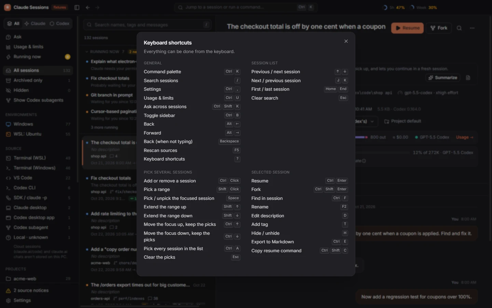

---

## Privacy and safety

The full rules are in [`CLAUDE.md`](CLAUDE.md) and
[docs/DETAILS.md → Safety in full](docs/DETAILS.md#safety-in-full). In short:

**What the app reads.** Session files in `.claude` and `.codex` folders (Windows and WSL), Claude
Code's running-session files, Codex's thread locks, `config.toml` and the Codex app's project list
(read only), your git repos (read only), and any claude.ai export zip you pick.

**What it never reads.** Sign-in files: Claude's and Cowork's `.credentials.json`, Codex's
`auth.json`, and anything credential-shaped. Codex's databases aren't opened either.

**What it never changes.** Nothing under any `.claude` or `.codex` folder is deleted or modified,
with these narrow, explained exceptions:

- Resuming a session whose file is **missing** copies the archived copy back (it can never overwrite
  a file).
- **Branch from here** adds one **new** session file (after you confirm, the first time).
- **Live limits** and **Session alerts** change only the `statusLine` / `hooks` key of Claude Code's
  `settings.json`, and **Codex approval alerts** only that home's `hooks.json`: each after you
  review the exact diff, with a backup first and an exact undo. `config.toml` and `auth.json` are
  never written.

There is no delete feature (Hide is a flag). The app's own data lives in
`%APPDATA%\ClaudeSessionDashboard\`, plus the backup folder you pick. If you turn on live limits or
alerts, it also keeps a small `.claude-session-dashboard` folder next to `.claude` in each home you
enabled (Windows, and each WSL user): the bridge and hook scripts (`bin`), and the readings and
events they save (`live`, `events`, `codex-events`). Other system changes are
opt-in and shown first: Windows' OpenSSH setup ([terminal access](#terminal-access-from-your-phone)),
one firewall rule for home Wi-Fi phone mode, and the Start with Windows entry.

**Network.** The app makes no network calls of its own, except these, each off until you turn it
on:

| Exception                      | When it's used                                                                                                                                                      |
| ------------------------------ | ------------------------------------------------------------------------------------------------------------------------------------------------------------------- |
| **Admin API reports**          | Only with an Admin API key: two read-only reporting endpoints on `api.anthropic.com` (usage and cost). Never session content. Standard keys cause no calls.         |
| **Phone companion**            | Listens on `127.0.0.1`, published to your own tailnet by `tailscale serve` (never Funnel or the public internet), or on one private LAN address in home Wi-Fi mode. |
| **Phone push alerts**          | Per phone: an end-to-end encrypted Web Push message to that phone's browser push service, holding only the kind of alert and a random reference.                    |
| **GitHub CLI (pull requests)** | After you say yes: `gh auth status` and `gh pr list` for github.com repos, run by your own `gh` with your own sign-in.                                              |

The window itself can't make requests: remote images in transcripts aren't loaded and spellcheck
is off. There are no updates, analytics or telemetry.

**What goes to Claude, and when.** Always through **your own** Claude Code (`claude -p` with no
tools, none of your settings, on your Claude subscription), only for these three features. How much
you see before anything is sent differs:

- **Summaries:** the conversation's text and one line per tool call, secrets masked. A one-time
  notice explains this before the first summary; after that, **Show exactly what is sent** is
  optional, and a summary you don't preview is sent without one. **Auto-summarize** (off by
  default) sends eligible idle sessions on its own, with no per-session preview
  ([more](#summaries-and-continue-fresh)).
- **Ask across sessions (content questions):** every question is previewed, and only the snippets
  the preview shows are sent, after you click **Send** ([more](#the-preview)).
- **Ask Claude about your usage:** aggregated numbers only. The preview is shown before questions
  until you tick **Don't show again** (Settings → **Ask Claude** turns it back on)
  ([more](#ask-claude-about-your-usage)).

Nothing is ever sent to Codex: `codex exec` can't be run without tools, so the app doesn't use it.
API keys are encrypted with Windows (DPAPI) and never shown, logged, backed up or put on a command
line.

---

## FAQ and troubleshooting

<details>
<summary><b>The 5-hour and weekly gauges are empty or say "No recent reading"</b></summary>

The Claude gauges come from Claude Code's status line, so they only update while Claude Code runs.
Send a message in Claude Code, then check that the environment says "Receiving data" in Settings →
**Live limits**. Live limits exist only for Pro and Max subscriptions. "No recent reading" means the
window reset since the last reading; it shows the last value with its date instead of 0%. Codex
gauges update when Codex writes its next log line. **Rescan now** in the Usage view re-reads the
logs.

</details>

<details>
<summary><b>A WSL distro is missing, "Not running" or "Can't read"</b></summary>

Stopped distros aren't scanned by default, because reading one starts it. Open the distro once (for
example `wsl -d Ubuntu`); the app re-checks every two minutes, or press <kbd>F5</kbd>. To scan
stopped distros anyway, turn on Settings → **Scan sources** → **Scan stopped WSL distros**.

</details>

<details>
<summary><b>My Codex sessions in WSL, or from the Codex desktop app, look odd</b></summary>

Each WSL user's `~/.codex` is read like the Windows one. The Codex desktop app can run its agent in
WSL but keep the session in the Windows `.codex`, so a session can have a Linux folder. Resume then
translates `/mnt/c/...` folders after checking them with the distro, and for a Linux-only folder
offers **Open in Codex app** instead of guessing. Details:
[docs/DETAILS.md → Codex](docs/DETAILS.md#codex).

</details>

<details>
<summary><b>Cloud sessions (claude.ai/code) or claude.ai chats aren't shown</b></summary>

They aren't stored on your PC, so there's nothing to read. A cloud session you pulled down to this
PC (teleported) does show. claude.ai chats can be imported from a claude.ai data export (Settings →
**Archive** → **Import claude.ai data export**).

</details>

<details>
<summary><b>The phone can't connect</b></summary>

Settings → **Phone** → **Troubleshooting** re-runs every check. The usual causes: the Tailscale VPN
switch is off on the phone, HTTPS certificates are off for your tailnet, another program uses the
port (change it under Advanced), or (home Wi-Fi) Windows treats the network as Public. **Copy AI help
prompt** gives an AI assistant [read-only steps](docs/AI-SETUP-GUIDE.md) to help, without secrets.

</details>

<details>
<summary><b>Notifications don't show up</b></summary>

On the PC: check Windows Settings → System → Notifications for the app and Do not disturb, and
Settings → **Session alerts** (the events you picked, quiet hours, muted sessions, the minimum
working time for "finished"). `logs\notifications.jsonl` in the data folder records whether Windows
showed each one. Without session alerts (hooks), states come from Claude Code's files and can lag a
little. On the phone: turn on push alerts on that phone; on an iPhone, open the app from the Home
Screen first.

</details>

<details>
<summary><b>Resume opens a window that closes at once (WSL)</b></summary>

Check that `claude` works in a login shell: `wsl -d <distro> -- bash -lic "claude --version"`.

</details>

<details>
<summary><b>"Claude Code wasn't found on this computer's PATH"</b></summary>

Check that `where.exe claude` finds it in a new terminal. If you installed it while the app was
open, restart the app. The app never runs a `claude` from the project folder.

</details>

<details>
<summary><b>A Codex session says "Needs approval?" with a question mark</b></summary>

Codex doesn't log approval requests, so without its hook the app guesses from a command that waits
for output. Settings → **Session alerts** → **Enable approval alerts** for that Codex home (then
trust the hook in Codex's `/hooks`) makes it exact.

</details>

<details>
<summary><b>Ask says content questions are off, or the index is still building</b></summary>

Content questions are off until you turn them on (Ask screen, or Settings → **Ask**). The first
index build runs in the background; local questions work meanwhile. **Rebuild** in Settings → **Ask**
starts over. The index leaves out the oldest sessions past its size limit (Settings → **Ask**).

</details>

<details>
<summary><b>Nothing shows up at all</b></summary>

Check Settings → **Scan sources**. If your `.claude` or `.codex` folder lives somewhere unusual,
**Add folder…**. Also check Settings → **Providers** hasn't turned an agent off, and the All / Claude
/ Codex switch.

</details>

<details>
<summary><b>SmartScreen blocks the installer</b></summary>

Click **More info**, then **Run anyway**. The exe isn't code-signed.

</details>

<details>
<summary><b>Where is my data, and how do I uninstall?</b></summary>

The app's data is in `%APPDATA%\ClaudeSessionDashboard\`. If you turned on live limits or alerts,
each home you enabled (Windows, and each WSL user) also has a `~/.claude-session-dashboard` folder
with the bridge and hook scripts and the readings and events they saved.

**Before uninstalling**, undo what you turned on, while the app can still undo it exactly:

1. Settings → **Live limits** → **Disable** for each environment (puts your previous `statusLine`
   back in Claude Code's `settings.json`).
2. Settings → **Session alerts** → **Disable** for each environment, and **Disable** approval alerts
   for each Codex home (takes the app's hooks out of `settings.json` and `~/.codex/hooks.json`).
3. Settings → **Phone** → turn phone access off (removes the app's Tailscale serve rule, and offers
   to remove its firewall rule in home Wi-Fi mode).
4. Settings → **Terminal access (SSH)** → **Turn off terminal access**, if you set it up.
5. Settings → **Startup** → turn **Start with Windows** off.

**Then** uninstall in Windows Settings → Apps → Claude Session Dashboard (this removes the program
only). To remove the data too, delete `%APPDATA%\ClaudeSessionDashboard\` (this deletes your archive
copies of old sessions), the `.claude-session-dashboard` folder in each home, and, if you used
backups, the `ClaudeSessionDashboard Backup` folder. Apart from the opt-in changes above, your
`.claude` and `.codex` folders are never modified.

</details>

More: [docs/DETAILS.md → More troubleshooting](docs/DETAILS.md#more-troubleshooting).

---

## Updating, versions and contributing

**Updating.** The app never updates itself (no network calls). Check
[Releases](https://github.com/Beaulewis1977/claude-session-dashboard/releases) and run the newer
installer over the old one. Your names, tags, archive, settings, paired phones and API keys are
kept, because they live in `%APPDATA%\ClaudeSessionDashboard\`. Your version is in Settings →
**About**.

**Versions.** [Semantic versioning](https://semver.org/): a minor version (1.16.0) adds features, a
patch version (1.15.2) only fixes things. Every version is described in [CHANGELOG.md](CHANGELOG.md).

**Contributing.** Issues and PRs are welcome. The workflow:

1. **Branch** from an up-to-date `main` (`feat/…`, `fix/…`, `docs/…`).
2. Read [`CLAUDE.md`](CLAUDE.md) first and keep to its safety rules (never modify `.claude`, no
   network calls, no native Node modules). Follow the existing style (TypeScript, function
   components, two-space indent, single quotes, no semicolons; `npm run format` applies Prettier).
3. Add tests for new behavior and never weaken existing ones. Use sample data only: no real keys,
   names, paths or addresses in code, tests or screenshots.
4. Run `npm run check` (from Git Bash), push, and **open a PR into `main`**.
5. **Review:** each PR gets an independent review, and the fixes go in as a follow-up commit on the
   same branch. It's merged with a merge commit.
6. **Release:** a small PR bumps the version (`npm version <x.y.z> --no-git-tag-version`) and adds
   the CHANGELOG entry. After it's merged, `npm ci`, `npm run check` and `npm run dist` on `main`
   build both exes into `release\<version>\`, and they're uploaded to a GitHub Release:

   ```powershell
   gh release create v<x.y.z> --target main --title "v<x.y.z>" --notes-file <notes.md> `
     "release\<x.y.z>\ClaudeSessionDashboard-Setup-<x.y.z>.exe" `
     "release\<x.y.z>\ClaudeSessionDashboard-Portable-<x.y.z>.exe"
   ```

There is no CI: releases are built and checked on a Windows PC.

---

## Author and support

**Designed and built by Beau Lewis**
📧 [BLewisxx@gmail.com](mailto:BLewisxx@gmail.com)

If Claude Session Dashboard helps you and you'd like to support more projects like this, any
contribution is hugely appreciated and goes directly toward building more tools that help real
people:

<p align="left">
  <a href="https://venmo.com/u/beauintulsa"></a>
  &nbsp;
  <a href="https://ko-fi.com/beaulewis"></a>
</p>

- **Venmo:** [@beauintulsa](https://venmo.com/u/beauintulsa)
- **Ko-fi:** [ko-fi.com/beaulewis](https://ko-fi.com/beaulewis)

Thank you for checking out Claude Session Dashboard. 💚

## License

Released under the **MIT License**. See [`LICENSE`](LICENSE) for details.
